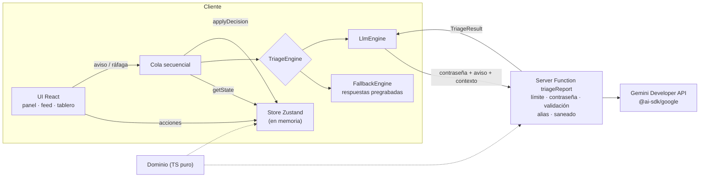

# EmergencyTriage

Prototipo de consola de operaciones para incidentes en edificios. Recibe avisos de texto libre, usa una IA para proponer cómo agruparlos en incidentes (categoría, gravedad, protocolo y resumen) y deja que una persona responsable de seguridad **valide, corrija o descarte** cada incidente.

> **Demo con datos ficticios. No es un sistema real de gestión de emergencias.** Los edificios, los protocolos y sus textos («[FICTICIO]») son inventados y no tienen validez operativa. La aplicación no ejecuta protocolos ni envía notificaciones.

- **URL pública:** https://emergency-triage-phi.vercel.app
- **Diseño completo:** [`docs/designs/emergency_triage.md`](docs/designs/emergency_triage.md)

## Stack

React 19, TypeScript, TanStack Start (con SSR), shadcn/ui, Tailwind CSS 4, Zustand, Vercel AI SDK 7 y despliegue en Vercel.

**Desviación deliberada del enunciado: no se usa Vercel AI Gateway.** El enunciado pide AI Gateway, pero en las pruebas devolvió un 403 incluso con sus modelos de precio 0: exige una tarjeta de crédito registrada para desbloquear los créditos gratuitos, y el objetivo del proyecto es coste 0 € sin tarjeta, sin planes y sin pagos. La IA se llama directamente a la **Gemini Developer API** con el proveedor oficial `@ai-sdk/google`, en su nivel gratuito. Volver al Gateway es un cambio pequeño: solo [`src/server/llm-client.ts`](src/server/llm-client.ts) importa el AI SDK.

## Cómo ejecutarlo

Requisitos: Node.js 22.9 o superior (probado con Node 26 en local y Node 24 en Vercel) y npm.

```bash
npm install
cp .env.example .env.local     # y rellena las variables (ver más abajo)
npm run dev                    # http://localhost:3000
```

| Comando | Qué hace |
|---|---|
| `npm run dev` | Servidor de desarrollo en el puerto 3000. Carga `.env.local`. |
| `npm run build` | Compila para producción en `.output/`. |
| `npm start` | Sirve el resultado de `npm run build` (puerto 3000, o `PORT=…`). Carga `.env.local` si existe. |
| `npm test` | 147 tests unitarios con Vitest. |
| `npm run typecheck` | `tsc --noEmit`. |

### Variables de entorno

Solo existen en el servidor. Ninguna lleva el prefijo `VITE_`, así que no llegan al navegador. `.env.local` está ignorado por git.

| Variable | Para qué | Cómo obtenerla |
|---|---|---|
| `GOOGLE_GENERATIVE_AI_API_KEY` | Clave de la Gemini Developer API. | En [Google AI Studio](https://aistudio.google.com/apikey), sin activar facturación. |
| `TRIAGE_MODEL` | ID del modelo de Gemini. Se ha usado `gemini-3.5-flash-lite`. | Un modelo de tu cuenta con salida estructurada. Los `gemini-2.5-*` ya no están disponibles para cuentas nuevas. |
| `DEMO_PASSWORD` | Contraseña compartida que protege las llamadas a la IA. 12 caracteres o más. | La eliges tú. |

Sin estas variables, el **modo sin API sigue funcionando** y el modo IA devuelve un error de configuración.

### Despliegue en Vercel

1. Crea el proyecto y define las tres variables (`GOOGLE_GENERATIVE_AI_API_KEY` como variable sensible) en Production y Preview.
2. `npx vercel deploy --prod`. El proyecto no está conectado a un repositorio de GitHub, así que cada despliegue es manual.
3. `vite.config.ts` fija `maxDuration` de la función en 30 s (comprobado en el despliegue).

## Cómo probarlo

La pantalla tiene un panel lateral (formulario, «Simular ráfaga», «Reiniciar demo», interruptor de modo), el feed de avisos y el tablero con las columnas Pendiente, Validado y Descartado.

### Modo sin API (no necesita contraseña ni claves)

1. Con el tablero vacío, activa el interruptor **«Modo sin API»**.
2. Pulsa **«Simular ráfaga»**: se procesan 9 avisos de uno en uno con respuestas pregrabadas (unos 8 s). Siempre da el mismo resultado:

   | Incidente | Avisos | Categoría | Gravedad | Relación |
   |---|---|---|---|---|
   | INC-1 | S1, S2, S4, S7 | Incendio/Humo | Crítica | — |
   | INC-2 | S3, S5 | Fallo Eléctrico | Media | — |
   | INC-3 | S6 | Incendio/Humo | Alta | relacionado con INC-1 |
   | INC-4 | S8 | Médico | Media | — |
   | INC-5 | S9 | «Fuga de agua» (no oficial) | Media | — |

3. Revisa los incidentes: **Editar** (los campos que cambies quedan bloqueados frente a la IA), **Validar**, **Descartar** y **Aprobar categoría** (en INC-5). Mientras la cola procesa, estas acciones y «Reiniciar» están desactivadas.
4. **«Reiniciar demo»** borra todo y conserva el modo.

El formulario manual está desactivado en este modo: solo hay respuestas pregrabadas para los 9 avisos del guion.

### Modo IA

1. Deja el interruptor en «Modo IA» y envía un aviso desde el formulario, por ejemplo *«Huele a quemado junto a la escalera»* en Torre Central, Planta 2.
2. Se abre el diálogo de **contraseña de demo** (el aviso queda «En cola»). Introduce `DEMO_PASSWORD`. Si es incorrecta, el aviso no se pierde y vuelve a pedirla. El diálogo no se puede cerrar; para salir, recarga la página.
3. Prueba los casos del diseño:
   - **Mismo suceso, misma planta:** un segundo aviso («Hay olor a humo en el pasillo») se agrupa en el mismo incidente.
   - **Otra planta:** «Hay humo saliendo del hueco de la escalera» en la Planta 3 crea un incidente nuevo **relacionado** con el anterior.
   - **Tras validar un incidente**, un aviso sobre el mismo hecho crea uno nuevo relacionado con el validado.
   - **Categoría nueva:** *«Cae agua del techo en el almacén del sótano»* en Laboratorios, Sótano 1 propone la categoría no oficial «Fuga de agua».
4. Si la IA falla (límite de peticiones, tiempo agotado, respuesta no válida), el aviso queda como «Error: …» con **«Reintentar»**. No hay reintentos automáticos.
5. «Simular ráfaga» también funciona en este modo (9 llamadas reales). **Úsala con moderación**: el nivel gratuito tiene límites de frecuencia.

## Cómo está hecho



- **Dominio** (`src/domain/`): tipos y reglas en TypeScript puro, sin React ni AI SDK. `applyDecision` es una función pura y la **única comprobación que manda** sobre qué cambia en el estado.
- **La IA propone, el código decide.** La IA recibe alias cortos (`I1`, `C1`, `P1`…), nunca IDs reales. Una referencia inventada nunca llega al estado: un incidente no elegible no recibe el aviso, y una categoría o protocolo desconocidos devuelven un error.
- **Reglas de agrupación:** solo se agrupa en el mismo edificio y la misma planta; el mismo fenómeno en otra planta se **relaciona**, no se agrupa. Ante la duda, se separa.
- **La persona tiene la última palabra:** un campo editado queda bloqueado frente a la IA, la IA nunca baja la gravedad de un incidente, y solo una persona valida o descarta.
- **Cola secuencial** (`src/queue/`): un aviso cada vez, con el estado que dejó el anterior. Mientras procesa, el tablero no cambia por acciones del operador.
- **Servidor** (`src/server/`): una Server Function sin estado con límite de 20 peticiones por minuto por instancia, contraseña comparada en tiempo constante, entrada validada con Zod, `temperature 0`, 800 tokens como máximo, timeout de 15 s y `maxRetries: 0`. El razonamiento se pide con `reasoning: 'none'`; con `gemini-3.5-flash-lite` el SDK no puede desactivarlo del todo y lo traduce a esfuerzo `minimal`, y lo indica con un aviso en el log del servidor.
- **Estructura:** `src/domain/`, `src/data/` (edificios, protocolos, guion y respuestas pregrabadas), `src/ai/` (contrato y prompt), `src/server/`, `src/engines/`, `src/store/`, `src/queue/`, `src/components/`, `src/routes/`.

## Decisiones y limitaciones conocidas

**Decisiones de alcance** (documentadas en el diseño): el estado vive solo en memoria (una recarga empieza de cero); sin base de datos, varios usuarios ni persistencia; sin reintentos automáticos, ni cambio automático al modo sin API; sin fusión manual de incidentes ni estado «Resuelto»; solo escritorio (ancho mínimo de 1180 px), sin vista móvil.

**Limitaciones:**

- **Datos y protocolos ficticios.** Los textos de protocolo, rutas y puntos de reunión están inventados. El resumen y el motivo que genera la IA no se verifican y se muestran como «Texto generado por IA».
- **La IA no es determinista.** Con la misma ráfaga, el resultado puede variar. En las pruebas, la categoría nueva de S9 mejoró con el prompt `v2` (7 respuestas de 7 correctas), pero es una muestra pequeña y no hay garantía. El modo sin API reproduce siempre el guion.
- **Errores transitorios del proveedor.** En unas 45 llamadas hubo cuatro (dos `server`, un timeout y un 429). Un aviso en error deja la ráfaga incompleta hasta pulsar «Reintentar».
- **Los límites del nivel gratuito de Gemini no están verificados.** La API no los devuelve. Se observó un `rate_limit` tras unas 28 llamadas en pocos minutos, y no volvió a ocurrir con 3 s entre llamadas, lo que sugiere un límite por minuto. Según las condiciones del nivel gratuito, Google puede usar los datos enviados (no verificado aquí); por eso solo se envían datos ficticios.
- **El límite de peticiones es por instancia y global:** alguien con la URL puede agotar las 20 peticiones por minuto.
- **No hay pruebas automáticas de interfaz.** Los 147 tests cubren el dominio, el contrato con la IA, el prompt, los motores, la cola y el store. La interfaz se verificó a mano con un navegador real (Edge, con scripts de Playwright que no forman parte del repositorio), en local y en la URL pública. No se ha probado en móvil ni con lectores de pantalla más allá de las etiquetas básicas.
- **Una sola sesión y un solo navegador.** La contraseña se guarda solo en memoria.
- **Dependencia `cn`:** `shadcn init` (4.23) la instala para el estilo `radix-nova`, y los componentes la importan directamente.

## Licencia

Ver [`LICENSE`](LICENSE).
