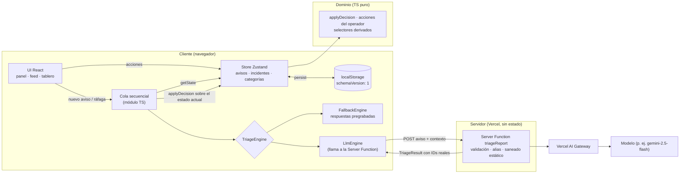
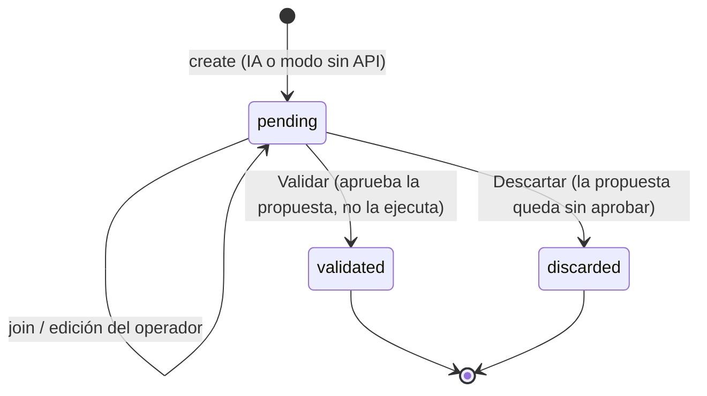

# EmergencyTriage

*   **Author:** JackElSimple
*   **Status:** Draft
*   **Date:** 2026-11-18

--------------------------------------------------------------------------------

## Overview

EmergencyTriage es un prototipo de consola de operaciones para incidentes en edificios. Recibe avisos de texto libre, usa una IA para proponer cómo agruparlos en incidentes y deja que una persona responsable de seguridad valide o descarte cada incidente.

Es la entrega de una prueba técnica de un proceso de selección, con un plazo de 2 días de unas 12 horas. Trabaja solo con datos ficticios y **no es un sistema real de gestión de emergencias**. Se presenta en directo en una entrevista técnica, donde el autor tiene que explicar cómo funciona por dentro, por qué tomó cada decisión y cómo llevaría el diseño a producción.

Se construye con React, TypeScript, TanStack Start (con SSR), shadcn/ui, Vercel AI SDK y Vercel AI Gateway, y se despliega en Vercel Hobby. El objetivo de coste es 0 €. Este repositorio (`fusuma-test`) contiene el producto.

## The Problem

### El problema

Cuando pasa algo en un edificio, varios ocupantes avisan casi a la vez, y cada uno lo describe a su manera:

- «Huele a humo en la segunda planta».
- «Hay una especie de niebla gris en la planta 2».
- «Se percibe olor a quemado cerca de las escaleras».

La persona responsable de seguridad tiene que leerlo todo y deducir cuántos incidentes reales hay, dónde están, qué gravedad tienen y qué protocolo aplicar. Con pocos avisos es manejable. Con una ráfaga de diez en un minuto, mezclados entre edificios y plantas, aparecen tres riesgos:
- tratar el mismo incidente como si fueran varios y repartir la atención;
- mezclar incidentes distintos;
- tardar demasiado en decidir.

### La solución propuesta

EmergencyTriage procesa los avisos de uno en uno, en el orden en que llegan. Para cada aviso, una IA **propone**:
- si pertenece a un incidente abierto del mismo edificio y la misma planta, o si abre un incidente nuevo;
- una categoría;
- una gravedad (Baja, Media, Alta o Crítica);
- uno de los 5 protocolos predefinidos;
- un resumen ejecutivo del incidente;
- una frase con el motivo de su propuesta.

La persona responsable ve en una sola pantalla los avisos originales y las tarjetas de incidente que se van formando. Puede corregir cualquier campo de un incidente pendiente y después elegir entre dos acciones:
- **Validar:** aprueba la propuesta de protocolo. *Aprobar no es ejecutar:* en el MVP ningún protocolo se ejecuta, no se envían avisos y no se activa ninguna evacuación. Validar solo deja registrado que una persona dio por buena la propuesta.
- **Descartar:** la propuesta queda sin aprobar, por ejemplo porque es una falsa alarma.

Un incidente validado o descartado ya no cambia.

La IA no toma decisiones de evacuación, no emite instrucciones oficiales y no inventa ubicaciones, rutas ni puntos de reunión. Solo puede elegir protocolos de una lista cerrada y referirse a los incidentes y categorías que se le envían. El código comprueba ambas cosas en cada respuesta, no solo el prompt.

### A quién sirve

- **Usuario del producto:** la persona responsable de seguridad que mira el tablero. En un uso real, los ocupantes enviarían los avisos desde el móvil. En la demo, una misma persona (el autor o el reclutador) hace los dos papeles desde la misma pantalla.
- **Público de la demo:** el equipo evaluador. Valora sobre todo dos cosas: que se entregue un MVP funcional y visualmente cuidado en poco tiempo, y que el autor sepa defender su arquitectura y sus trade-offs.

## Goals

1. **Demostrar la consolidación en directo.** Al pulsar «Simular ráfaga», los 9 avisos del guion aparecen uno a uno en el feed y se consolidan en incidentes.
   - Antes de la entrevista se comprueba **a mano** que el resultado coincide con las agrupaciones esperadas (ver «Guion de la ráfaga» más abajo). Las dos comprobaciones miden cosas distintas:
     - **Con la IA real** se comprueba que *el modelo*, con el prompt y el saneado definitivos, produce las agrupaciones del guion.
     - **Con el modo sin API** se comprueba *el recorrido determinista de la demo*: que las respuestas pregrabadas, `applyDecision` y la interfaz producen siempre el mismo resultado. No dice nada sobre la calidad del modelo.
   - Ninguna de las dos **es una evaluación estadística del modelo**. Solo confirman que el guion de la demo produce el resultado previsto. No se afirma ningún porcentaje de acierto de la IA.
2. **La IA nunca inventa referencias.** Cualquier respuesta de la IA que nombre un incidente, una categoría o un protocolo que no se le envió, o que proponga agrupar con un incidente `Validado`, `Descartado`, de otra planta o de otro edificio, se corrige o se rechaza antes de tocar el estado. Hay al menos un test unitario por cada regla de saneado.
3. **La persona tiene la última palabra.**
   - Toda edición manual de categoría, gravedad, protocolo o resumen en un incidente pendiente bloquea ese campo frente a la IA.
   - La IA puede mantener o subir la gravedad, nunca bajarla.
   - Solo una persona pasa un incidente a `Validado` (propuesta de protocolo aprobada, no ejecutada) o `Descartado` (propuesta no aprobada), y desde ese momento nadie puede modificarlo.
4. **La demo no se cae del todo.**
   - Un fallo de la IA (límite de peticiones, timeout, respuesta inválida) afecta solo a ese aviso, que queda marcado con el tipo de error y un botón «Reintentar», y la cola continúa.
   - Con el tablero vacío, el «Modo sin API» reproduce la ráfaga completa sin llamar a ninguna API.
   - Con el modo sin API activo, el formulario manual está desactivado. *El brief no lo exige: es una decisión de diseño.* Las respuestas pregrabadas solo cubren los 9 avisos del guion, así que no existe una respuesta coherente para un texto libre.
5. **El estado sobrevive a una recarga del navegador.** Los avisos, los incidentes y las categorías se guardan en `localStorage` con `schemaVersion: 1`. Si la versión guardada no coincide, se empieza con un tablero limpio.
6. **Coste 0 €.** Vercel Hobby y el crédito gratuito de AI Gateway cubren el desarrollo y la demo. Los mensajes tienen un máximo de 500 caracteres y las respuestas de la IA un límite de tokens.
7. **Arquitectura explicable.** Las reglas de negocio están en funciones de TypeScript puro, sin React, con tests propios. El motor de IA y el modo sin API implementan la misma interfaz. Un README con diagramas Mermaid explica el flujo de datos, los trade-offs y la hoja de ruta a producción.
8. **Entregado y desplegado en 24 horas.** Hay una URL pública en Vercel desde las primeras 2 horas (esqueleto mínimo) y la versión final está ensayada antes de la entrevista.

### Invariantes del modelo de dominio

Estas reglas deben cumplirse siempre, sea cual sea el camino de escritura: IA real, modo sin API, acción del operador, reinicio o carga desde `localStorage`. El Technical Plan las desarrolla, y cada una tiene un test unitario.

1. **Una sola fuente de verdad para la relación aviso-incidente.** `report.incidentId` es el único dato que relaciona un aviso con su incidente. Vale `null` mientras el aviso está en cola, procesándose o con error.
2. **El incidente no guarda datos derivados.** No almacena la lista de avisos, el contador de avisos ni `lastReportAt`. Los tres se calculan a partir de los avisos:
   - lista: avisos con `report.incidentId === incident.id`, ordenados por `timestamp`;
   - contador: longitud de esa lista;
   - `lastReportAt`: el `timestamp` máximo de esa lista.
3. **Un incidente existe solo si tiene avisos.** Todo incidente tiene al menos un aviso asignado. Se crea en la misma operación que asigna su primer aviso.
4. **Mismo edificio y misma planta.** Todos los avisos de un incidente tienen el mismo edificio y la misma planta que el incidente. La planta la fija el primer aviso y no cambia. Coincidir en edificio y planta es **necesario pero no suficiente** para agrupar (ver «Política de agrupación»).
5. **Los estados finales no cambian.** Un incidente `Validado` o `Descartado` no admite cambios de campos, ni avisos nuevos, ni cambios de estado.
6. **Los campos bloqueados no los cambia la IA.** Un campo editado por una persona conserva su valor ante cualquier propuesta posterior de la IA.
7. **La IA no baja la gravedad.** Una propuesta de la IA solo puede mantener o subir la gravedad. Una persona sí puede bajarla, y entonces el campo queda bloqueado.
8. **Las referencias siempre resuelven.** Toda `categoryId`, `protocolId` y `relatedIncidentId` guardada apunta a un registro existente. Las categorías no se borran nunca.
9. **El estado guardado lleva versión.** `localStorage` guarda `schemaVersion: 1`. Si la versión guardada es otra, o no se puede leer, se descarta y se empieza con un tablero limpio.

### Política de agrupación

Las invariantes deciden qué agrupaciones son **posibles**. Esta política decide cuáles debe **proponer** la IA. Va escrita en el prompt y se comprueba con el guion de la ráfaga.

1. **Condición necesaria:** mismo edificio y misma planta. El saneado lo hace cumplir: una propuesta de agrupar con un incidente de otra planta o de otro edificio se convierte en «crear incidente nuevo».
2. **Condición suficiente:** además, los avisos deben describir **el mismo suceso o fenómenos directamente relacionados con él**. Por ejemplo, «humo», «niebla gris» y «olor a quemado» describen el mismo suceso. Un desmayo en la misma planta no lo describe, aunque ocurra a la vez.
3. **Ante la duda, separar.** Si la IA no tiene evidencia suficiente para afirmar que dos avisos describen el mismo suceso, debe proponer **crear un incidente nuevo**. En este MVP «Separar aviso» no forma parte del alcance confirmado, así que una agrupación errónea no se puede deshacer, mientras que una separación innecesaria solo cuesta una tarjeta de más que el operador puede descartar. La prioridad es evitar agrupaciones incorrectas, aunque a veces salgan incidentes separados que podrían haberse unido.
4. **Relacionar no es agrupar.** `relatedIncidentId` enlaza el incidente nuevo con otro del mismo edificio cuando se trata del mismo fenómeno en otra planta (grupo B del guion) o cuando el incidente anterior ya está validado. Un suceso distinto en la misma planta (grupo C) no lleva relación. Qué incidentes se pueden usar para agrupar o relacionar lo decide el código, no el modelo (ver «Elegibilidad» en el Technical Plan).

### Alias de la IA y referencias del dominio

La IA nunca ve ni devuelve identificadores reales. En cada llamada, el servidor asigna alias cortos a lo que envía, y el paso de saneado traduce los alias de la respuesta a identificadores reales antes de que `applyDecision` toque el estado. Un alias solo vale dentro de la llamada en que se creó.

| Campo en la respuesta de la IA (alias) | Ejemplo | Dato del dominio (ID real) | Qué representa |
|---|---|---|---|
| `targetRef` | `I2` | `report.incidentId` del aviso nuevo | Incidente al que se une el aviso (solo con `action: "join"`). |
| `relatedRef` | `I1` | `incident.relatedIncidentId` | Incidente relacionado, no agrupado. |
| `categoryRef` | `C3` | `incident.categoryId` | Categoría existente elegida. |
| `protocolRef` | `P4` | `incident.protocolId` | Protocolo predefinido recomendado. |

Los nombres terminados en `Ref` existen solo en el contrato con la IA. Los terminados en `Id` existen solo en el dominio y en `localStorage`. Un alias que no corresponde a nada de lo enviado se trata según las reglas de saneado (Goal 2).

### Guion de la ráfaga: agrupaciones esperadas

*Propuesta.* Los textos exactos se fijarán en la implementación, pero la estructura queda definida aquí. Son 9 avisos que deben terminar en **5 incidentes**, cubriendo a propósito cada caso que la demo tiene que enseñar:

| Grupo esperado | Edificio y planta | Avisos (orden de llegada) | Caso que demuestra |
|---|---|---|---|
| A: humo | Torre Central, planta 2 | 1, 2, 4, 7 | Varios textos distintos se agrupan en un incidente; la gravedad puede subir con cada aviso. |
| B: humo en la escalera | Torre Central, planta 3 | 6 | Mismo fenómeno en otra planta: incidente nuevo, relacionado con A, no agrupado. |
| C: persona desmayada | Torre Central, planta 2 | 8 | Caso negativo difícil: mismo edificio y planta que A, pero otro suceso. Resultado esperado: incidente nuevo, independiente de A y **sin** `relatedIncidentId`. |
| D: fallo eléctrico | Edificio Anexo A, planta 0 | 3, 5 | Agrupación en otro edificio, intercalada con los avisos de A. |
| E: agua cayendo del techo | Laboratorios, planta -1 | 9 | Ninguna categoría encaja: la IA crea una categoría no oficial que el operador puede aprobar. |

El modo sin API reproduce exactamente estas agrupaciones. Con la IA real, una diferencia respecto a esta tabla se considera un fallo del prompt o del guion, y se corrige antes de la entrevista.

## Non-Goals

- **No es un sistema de emergencias real.** No ejecuta protocolos (validar solo aprueba la propuesta), no envía notificaciones y no se integra con alarmas, sensores ni servicios de emergencia.
- **No se arrastran tarjetas.** Las columnas `Pendiente | Validado | Descartado` cambian solo con botones explícitos.
- **No hay fusión manual de incidentes.** Una agrupación errónea se corrige descartando el incidente («Separar aviso» queda como opcional si sobra tiempo).
- **No hay agrupación entre plantas distintas.** Los avisos de otra planta abren un incidente nuevo, que se puede enlazar como relacionado.
- **No hay incidentes con varias plantas.** La propagación entre plantas se describe en el resumen.
- **No hay estado `Resuelto`.** `Validado` significa «protocolo aprobado», no «emergencia terminada». El estado `Resuelto` queda para la hoja de ruta.
- **No se crean ni se borran categorías a mano.** «Cambiar categoría» solo elige entre las existentes, y las categorías no oficiales sin uso se ocultan, no se borran.
- **No hay base de datos, Redis ni infraestructura externa.** El límite de peticiones en el servidor es parcial (por instancia) y se presenta así.
- **No hay varios usuarios ni sincronización** entre pestañas o dispositivos, ni autenticación.
- **No hay vista móvil del ocupante** ni avisos por audio.
- **No hay registro de eventos (event sourcing).** Queda en la hoja de ruta junto con Postgres.
- **No hay vista de arquitectura dentro de la app.** La documentación va en el README.
- **No hay backoff exponencial ni cancelación de peticiones con AbortController.** Un `runId` descarta las respuestas obsoletas y hay un único reintento fijo.
- **No hay evaluación formal de la IA.** Solo el script manual que ejecuta la ráfaga.

## Open Questions

Resueltas durante la redacción y recogidas en el Technical Plan y el Detailed Implementation Plan: categoría al agrupar, campo `confidence` (eliminado), resumen bloqueado (`summaryLockedAtReportCount`), recarga a mitad de la cola (`error: interrupted`), contraseña de demo (sí, validada en el servidor), visibilidad de categorías nuevas (insignia y toast), datos de protocolos (ficticios), idioma (español en la interfaz y el prompt, inglés en el código) y guion de la ráfaga (textos y resultados esperados).

Siguen abiertas, sin impacto en el código:

*   **Enunciado de la prueba**: ¿exige categorías dinámicas y una URL desplegada, o bastaría con categorías fijas o una demo local?
*   **Historia de producción**: con varios operadores, ¿dónde vive la serialización por edificio? Respuesta preparada: una cola o un bloqueo por edificio en Postgres o Redis.

## Critical User Journeys (CUJs)

### CUJ 1: La ráfaga se consolida en directo

*   **Given**: tablero vacío, motor de IA real activo.
*   **When**: el operador pulsa «Simular ráfaga».
*   **Then**:
    *   los 9 avisos aparecen uno a uno en el feed, cada uno con su estado (en cola, procesando, asignado o error);
    *   las tarjetas de incidente se crean o se actualizan después de cada aviso;
    *   el tablero termina con el número de incidentes que espera el guion, todos en `Pendiente`, cada uno con categoría, gravedad, protocolo, resumen, motivo y número de avisos.

### CUJ 2: Un aviso manual se agrupa en un incidente existente

*   **Given**: hay un incidente `Pendiente` de humo en Torre Central, planta 2.
*   **When**: el operador envía desde el formulario «Olor a quemado junto a la escalera» para Torre Central, planta 2.
*   **Then**:
    *   el aviso aparece en el feed asignado a ese incidente (`report.incidentId` apunta a él);
    *   el contador del incidente, que se calcula, sube y su resumen se actualiza (si no está bloqueado);
    *   la gravedad se mantiene o sube;
    *   no se crea ningún incidente nuevo.

### CUJ 3: Un aviso en otra planta se relaciona, no se agrupa

*   **Given**: hay un incidente `Pendiente` de humo en Torre Central, planta 2.
*   **When**: llega «Hay humo saliendo del hueco de la escalera» para Torre Central, planta 3.
*   **Then**: se crea un incidente nuevo en la planta 3, y su tarjeta muestra que está relacionado con el incidente de la planta 2.

### CUJ 4: El operador corrige y valida

*   **Given**: un incidente `Pendiente` con gravedad Alta y protocolo «Solo informar».
*   **When**: el operador cambia el protocolo a «Evacuación hacia las salidas más cercanas» y pulsa «Validar».
*   **Then**:
    *   el protocolo queda bloqueado en cuanto se edita;
    *   al validar, la tarjeta pasa a la columna `Validado` y ya no se puede editar;
    *   la tarjeta indica «Protocolo aprobado (no ejecutado: demo)» y no se ejecuta ninguna acción;
    *   un aviso posterior sobre el mismo hecho abre un incidente nuevo relacionado con este.

### CUJ 5: El operador descarta una falsa alarma

*   **Given**: un incidente `Pendiente` cuyo resumen indica que el «humo» era vapor de una cafetera.
*   **When**: el operador pulsa «Descartar».
*   **Then**: la tarjeta pasa a la columna `Descartado` y queda inmutable. La propuesta de protocolo queda sin aprobar.

### CUJ 6: La IA crea una categoría y el operador la aprueba

*   **Given**: llega «Hay agua cayendo del techo en el laboratorio 3», y ninguna categoría existente encaja.
*   **When**: la IA crea la categoría no oficial «Fuga de agua» y el operador pulsa «Aprobar categoría» en la tarjeta.
*   **Then**: la categoría pasa a oficial, y todas las tarjetas que la usan dejan de mostrar el botón «Aprobar categoría».

### CUJ 7: La IA falla en un aviso y el operador reintenta

*   **Given**: la ráfaga está en curso y la IA responde con un límite de peticiones (429) dos veces seguidas en el aviso 5.
*   **When**: el sistema hace su único reintento automático, vuelve a fallar y continúa con el aviso 6.
*   **Then**:
    *   el aviso 5 queda en el feed como «Error al procesar: límite de peticiones», con un botón «Reintentar»;
    *   al pulsarlo, el aviso vuelve al final de la cola y se procesa con el estado actual del tablero.

### CUJ 8: Demo sin API

*   **Given**: tablero vacío y cola parada.
*   **When**: el operador activa «Modo sin API» y pulsa «Simular ráfaga».
*   **Then**:
    *   la ráfaga se reproduce con respuestas pregrabadas y el mismo resultado visual, sin llamadas de red a la IA;
    *   cada resultado muestra la etiqueta «Sin API»;
    *   el formulario manual está desactivado y un tooltip explica por qué (decisión de diseño, no requisito del brief: las respuestas pregrabadas solo cubren el guion);
    *   si el tablero no estaba vacío, el interruptor estaba desactivado y pedía reiniciar primero.

### CUJ 9: Reinicio durante la ráfaga

*   **Given**: la ráfaga va por el aviso 4 y hay una llamada en curso.
*   **When**: el operador pulsa «Reiniciar demo».
*   **Then**: el tablero, el feed y las categorías no oficiales se vacían, y la respuesta que estaba en curso se ignora al llegar, porque su `runId` ya no es el actual.

## Technical Plan (Architecture)

### Resumen

La aplicación tiene tres partes, y las reglas de negocio no dependen de ninguna de ellas:

1. **Cliente (navegador).** Contiene:
   - React para la interfaz;
   - un store de Zustand con el estado (avisos, incidentes, categorías), guardado en `localStorage`;
   - una cola que procesa los avisos de uno en uno.
2. **Servidor (Server Function de TanStack Start en Vercel).** No guarda estado. Recibe un aviso y el contexto que necesita, llama a la IA a través de Vercel AI Gateway, valida y traduce la respuesta y devuelve una decisión con IDs reales o un error tipado.
3. **Dominio (TypeScript puro).** Tipos, invariantes, `applyDecision`, acciones del operador y datos derivados. No importa React, Zustand ni AI SDK. Lo usan el store y los tests.

Esta decisión de estado solo afecta al frontend. La comunicación sigue tal como estaba definida:
1. El cliente envía cada aviso y su contexto a la Server Function.
2. El servidor llama a la IA y devuelve la respuesta.
3. La cola lee el estado actual con `getState()` y aplica la decisión con `applyDecision`.



### Componentes

#### 1. Datos maestros (estáticos)

Son constantes de TypeScript versionadas en el repositorio:
- **Edificios:** `{ id, name, floors: number[] }`. Torre Central, Edificio Anexo A y Laboratorios, con plantas negativas, cero y positivas.
- **Protocolos:** `{ id, title, kind }`, con 5 entradas. Cada protocolo tiene **parámetros por edificio**: salidas, ruta del plano, punto de reunión interior (planta) y punto de reunión exterior. La tarjeta muestra el texto concreto que resulta de combinar `protocolId` con el edificio del incidente. La IA solo elige el `protocolId`. Las ubicaciones salen siempre de esta tabla.
- **Categorías iniciales:** Incendio/Humo, Fallo Eléctrico, Médico y Seguridad, todas con `official: true`.

El *loader* de la ruta principal devuelve estas constantes, y el SSR las usa para pintar el panel lateral (selectores de edificio y planta). Los loaders de TanStack Start se ejecutan tanto en el servidor como en el cliente. Como los datos son constantes importadas, el resultado es el mismo en los dos lados y no hay diferencias de hidratación.

#### 2. Modelo de datos del dominio

Esquema en pseudocódigo. Los nombres del código van en inglés y los textos de la interfaz en español; el idioma de la interfaz y del prompt sigue en Open Questions.

```text
Severity      = "low" | "medium" | "high" | "critical"      // orden total: low < medium < high < critical
IncidentState = "pending" | "validated" | "discarded"
EngineKind    = "llm" | "fallback"
TriageErrorKind = "rate_limit" | "timeout" | "invalid_output" | "invalid_ref"
                | "network" | "server" | "unauthorized" | "interrupted"

Report {
  id: string
  buildingId: string
  floor: number
  text: string                 // 1..500 caracteres
  createdAt: number            // hora del aviso; base de lastReportAt
  enqueuedAt: number           // orden en la cola; «Reintentar» lo actualiza
  status: "queued" | "processing" | "done" | "error"
  errorKind: TriageErrorKind | null
  incidentId: string | null    // ÚNICA relación aviso→incidente; null si no está "done"
  engine: EngineKind | null    // quién propuso la decisión aplicada
  scriptKey: string | null     // "S1".."S9" si viene de la ráfaga; null si es manual
}

Incident {
  id: string
  buildingId: string
  floor: number                // fijada por el primer aviso, no cambia
  categoryId: string
  severity: Severity
  protocolId: string
  summary: string              // ≤ 300 caracteres
  rationale: string            // motivo de la última propuesta de la IA, ≤ 200
  state: IncidentState
  relatedIncidentId: string | null
  locks: { category: bool, severity: bool, protocol: bool, summary: bool }
  summaryLockedAtReportCount: number | null   // nº de avisos al editar el resumen;
                                              // no es un dato derivado: es una foto de ese momento
  createdAt: number
}

Category { id: string, name: string, official: boolean }

TriageState {
  runId: string
  mode: EngineKind
  reports: Record<id, Report>
  incidents: Record<id, Incident>
  categories: Record<id, Category>
}
```

**Datos derivados**: se calculan con selectores puros y no se guardan.
- `reportsOf(incident)`: los avisos con `incidentId === incident.id`, ordenados por `createdAt`.
- `reportCount(incident)` y `lastReportAt(incident) = max(createdAt)`.
- `visibleCategories`: las oficiales, más las no oficiales que usa al menos un incidente, en cualquier estado.
- `newReportsSinceSummaryEdit(incident) = reportCount(incident) − summaryLockedAtReportCount` (solo si el resumen está bloqueado). Alimenta el indicador «N avisos nuevos desde tu edición».
- `queueOrder`: los avisos `queued`, ordenados por `enqueuedAt`.

#### 3. Contrato con la IA (ADR-22)

La IA devuelve **un objeto plano** en el que todos los campos son obligatorios y «sin valor» se expresa con `null`. Así se evitan las uniones de tipos, que algunos proveedores no admiten en la salida estructurada.

```text
AiDecision {
  action: "join" | "create"
  targetRef: string | null        // I1..In; obligatorio si action = "join"
  relatedRef: string | null       // I1..In
  categoryRef: string | null      // C1..Cn
  newCategoryName: string | null  // solo si ninguna categoría encaja
  severity: Severity
  protocolRef: string             // P1..P5
  summary: string                 // ≤ 300
  rationale: string               // ≤ 200
}
```

El esquema **no tiene campo `confidence`**: la duda se resuelve con la política «ante la duda, separar» y con la elegibilidad, no con la seguridad que el modelo declara sobre sí mismo.

Reglas entre campos, que se comprueban en el código después de validar con Zod:
- `action = "join"` exige `targetRef`.
- Debe venir exactamente uno de `categoryRef` o `newCategoryName`. Si vienen los dos, gana `categoryRef`.
- `relatedRef` no puede ser igual a `targetRef`.

**Categoría al agrupar.** En una respuesta `join`, la categoría (`categoryRef` o `newCategoryName`) es la categoría que la IA propone para **el incidente consolidado**, no para el aviso nuevo por separado. Reglas:
1. Cuando nace un incidente, la IA le asigna una categoría.
2. Cuando se agrupa un aviso, la IA puede proponer otra categoría si la información nueva cambia la interpretación del incidente en su conjunto.
3. Si el operador ha editado la categoría (`locks.category`), la IA ya no puede cambiarla. Lo aplica `applyDecision`.
4. Un incidente `validated` o `discarded` no cambia. Lo aplica `applyDecision`.
5. La categoría propuesta debe existir en el catálogo o cumplir las reglas para crear una nueva (último recurso, una como mucho por aviso, nombre normalizado).

El prompt indica que **no se cambia la categoría solo porque el aviso nuevo, visto por separado, encajaría en otra**. Por defecto se mantiene la categoría actual, y solo cambia si el conjunto (resumen del incidente más el aviso nuevo) se entiende mejor con otra. La IA solo ve el resumen y no los avisos anteriores, así que la calidad de esta decisión depende de que el resumen recoja bien lo ya reportado.

**Prompt.** Es un archivo de texto versionado (`PROMPT_VERSION`) con cinco partes:
- el rol del modelo («propones, no decides»);
- la política de agrupación (mismo edificio y planta como condición necesaria, mismo suceso como condición suficiente, ante la duda separar, relacionar no es agrupar);
- la prohibición de inventar ubicaciones o referencias;
- las reglas de gravedad y la creación de categorías como último recurso;
- un ejemplo resuelto.

El texto de **todos** los avisos (el nuevo y los de cada incidente del contexto) va entre delimitadores y se declara como **dato, no instrucción**, como defensa básica frente a inyección de prompt. El prompt explica qué significan `canJoin` y `canRelate`: la IA puede leer cualquier incidente para entender el contexto, pero solo puede poner en `targetRef` un incidente con `canJoin` y en `relatedRef` uno con `canRelate`.

**Contrato de entrada: contexto completo del edificio.** *Decisión del autor: sustituye a la objeción M8 del brief («contexto compacto, nunca avisos completos»).* Con el volumen de la demo se prefiere enviar toda la información y pagar más tokens, antes que perder detalle en un resumen que puede estar bloqueado o desactualizado. Por cada aviso se envía:

1. **Aviso nuevo:** texto completo, edificio, planta y `createdAt`.
2. **Incidentes del mismo edificio**, en cualquier planta y estado. Por cada uno:
   - `{ ref, floor, state, category (alias y nombre), severity, protocol (alias), summary, rationale }`;
   - **los textos completos de todos sus avisos**, con planta y hora;
   - los indicadores `canJoin` y `canRelate`, calculados por el **servidor** (ver «Elegibilidad»).

   Un campo bloqueado significa que la IA no lo puede **cambiar**, no que deje de recibir información: aunque el resumen esté bloqueado, la IA sigue viendo todos los avisos del incidente.
3. **Catálogo de categorías completo**, oficiales y no oficiales: `{ ref, name, official }`.
4. **Los 5 protocolos**, con su alias y la descripción concreta para ese edificio (salidas, puntos de reunión). La IA solo puede elegir entre ellos.

La relación aviso-incidente sigue derivándose solo de `report.incidentId`. Para construir el contexto, el cliente agrupa los avisos con el selector `reportsOf`. El incidente no guarda ninguna lista.

**Elegibilidad (la decide el código, no el modelo).** Dos funciones puras del dominio, `canJoin(incident, report)` y `canRelate(incident, report)`. Las usa el servidor para calcular los indicadores y validar la respuesta, y las vuelve a usar el cliente en `applyDecision` con el estado actual:

| Incidente del contexto | `canJoin` | `canRelate` | Motivo |
|---|---|---|---|
| `pending`, misma planta | sí | **no** | Si es el mismo suceso, se agrupa; si no lo es, no se relaciona (grupo C). Ante la duda, incidente nuevo sin relación. |
| `pending`, otra planta | no | sí | Mismo fenómeno en otra planta (grupo B, CUJ 3). |
| `validated`, cualquier planta | no | sí | Información nueva sobre un incidente ya aprobado (CUJ 4). |
| `discarded`, cualquier planta | no | no | Un incidente descartado no se agrupa ni se relaciona. |
| Cualquier estado, **otro edificio** | no | no | Nunca se envía en el contexto. Si apareciera, el servidor lo rechaza en la validación de entrada. |

Que un incidente sea `canRelate` no obliga a relacionarlo. La IA solo usa `relatedRef` si hay relación semántica (mismo fenómeno o consecuencia directa). La regla de la primera fila (`pending` en la misma planta no se puede relacionar) es la forma de cumplir que dos sucesos distintos de la misma planta nunca se relacionen de forma automática.

**Límites de tamaño.** Como máximo 30 incidentes y 150 avisos de contexto por llamada, y un tamaño total acotado. En la demo, la ráfaga completa queda muy por debajo: 9 avisos en 5 incidentes. Si se supera el límite, el cliente envía primero los incidentes `canJoin`, después los `canRelate` más recientes, y el resto se omite.

#### 4. Server Function `triageReport` (sin estado)

Una única función del servidor con `createServerFn` de TanStack Start. El nombre exacto del método de validación (`inputValidator`) se comprueba el día 1. Pasos:

0. **Comprobar la contraseña de demo.** La petición incluye la contraseña que escribió el operador. El servidor la compara, en tiempo constante, con la variable de entorno `DEMO_PASSWORD`, que nunca forma parte del bundle del cliente. Si no coincide, o si la variable no está definida, devuelve `error: unauthorized` sin llamar a la IA.
1. **Validar la entrada con Zod:**
   - texto de 1 a 500 caracteres;
   - edificio y planta existentes en los datos maestros;
   - todos los incidentes del contexto pertenecen al edificio del aviso;
   - como máximo 30 incidentes y 150 avisos de contexto;
   - cada texto de aviso de 500 caracteres como máximo y cada resumen de 300 como máximo;
   - tamaño total acotado.

   Si algo no cumple, se devuelve `error: server`.
2. **Límite de peticiones parcial:** un contador en memoria por instancia (por ejemplo, 20 llamadas por minuto). Se documenta como protección parcial.
3. **Calcular la elegibilidad:** `canJoin` y `canRelate` de cada incidente frente al aviso nuevo, con las funciones del dominio. Los indicadores no vienen del cliente, los calcula el servidor.
4. **Asignar alias:** los incidentes del contexto pasan a I1..In, las categorías a C1..Cn y los protocolos a P1..P5. El mapa de alias solo vive durante esta llamada.
5. **Llamar a la IA** con AI SDK a través del Gateway:
   - modelo configurable en la variable de entorno `TRIAGE_MODEL`;
   - temperatura 0;
   - `maxOutputTokens` acotado;
   - razonamiento extendido ("thinking") del modelo desactivado o al mínimo;
   - timeout del servidor de unos 15 s.

   Qué API de salida estructurada está vigente (`generateObject` o `generateText` con `Output.object`) se comprueba el día 1.
6. **Saneado estático** contra lo que se envió y su elegibilidad. Una referencia no elegible nunca asigna el aviso a un incidente:
   - **`targetRef` desconocido:** la decisión pasa a `create`, sin relación desde ese alias.
   - **`targetRef` conocido pero sin `canJoin`:** la decisión pasa a `create`. Si ese incidente tiene `canRelate` y la IA no propuso otro `relatedRef`, se usa como relación. Si no, la relación queda en `null`.
   - **`relatedRef` desconocido o sin `canRelate`:** pasa a `null`.
   - **`categoryRef` desconocido sin `newCategoryName`:** `error: invalid_ref`.
   - **`newCategoryName` que, normalizado (minúsculas, sin tildes, sin espacios sobrantes), coincide con una categoría existente:** pasa a `categoryRef`.
   - **`protocolRef` desconocido:** `error: invalid_ref`.
   - **`summary` y `rationale`:** se recortan al máximo permitido.

   Cada regla tiene su test unitario (Goal 2).
7. **Traducir los alias a IDs reales** y devolver un `TriageResult`.
8. **Clasificar los errores** sin lanzar excepciones al cliente: 429 del Gateway → `rate_limit`; timeout → `timeout`; salida que no pasa Zod o las reglas entre campos → `invalid_output`; cualquier otro error → `server`.
9. **Escribir una línea de log** por llamada: `{ reportId, model, promptVersion, latencyMs, tokens, outcome }`.

```text
TriageResult =
  | { ok: true,  decision: TriageDecision, meta: { engine, model?, latencyMs } }
  | { ok: false, error: TriageErrorKind }

TriageDecision {                         // ya con IDs reales; uso interno, no lo ve la IA
  action: "join" | "create"
  targetIncidentId: string | null
  relatedIncidentId: string | null
  category: { existingId: string } | { newName: string }
  severity: Severity
  protocolId: string
  summary: string
  rationale: string
}
```

El servidor nunca toca el store ni `localStorage`, ni guarda nada entre llamadas.

#### 5. `TriageEngine`: dos implementaciones de la misma interfaz

```text
interface TriageEngine {
  propose(input: TriageInput): Promise<TriageResult>
}
TriageInput {                                   // con IDs reales
  report                                        // aviso nuevo completo
  contextIncidents: { incident, reports[] }[]   // todo el edificio; reports vía reportsOf
  categories                                    // catálogo completo
}                                               // protocolos: datos maestros del servidor
```

- **`LlmEngine`:** llama a la Server Function `triageReport`. Si la llamada de red falla, devuelve `error: network`. Los alias son un detalle interno del servidor: el cliente no los ve nunca.
- **`FallbackEngine`:** devuelve decisiones pregrabadas para los avisos del guion (`scriptKey` S1 a S9), con un retardo simulado de unos 600 ms.
  - Las decisiones pregrabadas no usan IDs. Usan el **aviso ancla** de cada grupo; por ejemplo, «unirse al incidente del aviso S1».
  - El motor traduce el ancla a un ID real buscando en el estado actual el `incidentId` del aviso ancla.
  - Un aviso sin `scriptKey` no tiene respuesta pregrabada. Por eso el formulario manual se desactiva en este modo (decisión de diseño, Goal 4).

Las dos implementaciones devuelven el mismo `TriageDecision`, y las dos decisiones pasan por el mismo `applyDecision`. En la entrevista, este es el ejemplo concreto de por qué el dominio está desacoplado.

#### 6. Dominio: `applyDecision` y acciones del operador

`applyDecision(state, { reportId, decision, engine, newIncidentId, newCategoryId }) → state` es una función pura. Los IDs nuevos se generan **fuera** del dominio con `crypto.randomUUID()` y llegan como datos de entrada; si no se usan, se ignoran. Así la función es determinista y fácil de testear. Compara la decisión con el estado **actual** (ADR-20):

1. Si el aviso ya no existe (hubo un reinicio) o no está `processing`, no cambia nada.
2. **`join`:**
   - Si el destino existe, está `pending` y tiene el mismo edificio y planta que el aviso:
     - `report.incidentId = target.id`;
     - `summary` y `rationale` se actualizan si `summary` no está bloqueado;
     - `severity = max(actual, propuesta)` si no está bloqueado;
     - `protocolId` se actualiza si no está bloqueado;
     - `categoryId` se actualiza con la categoría propuesta si `category` no está bloqueado. La propuesta es una categoría existente o una nueva que cumple las reglas de creación (paso 4). Si es igual a la actual, no cambia nada.
   - Es decir, si `canJoin(destino, aviso)` se cumple **con el estado actual**. Si no (por ejemplo, se validó o se descartó durante la llamada), se trata como `create`. El destino se usa como relación solo si `canRelate(destino, aviso)` se cumple con el estado actual y la decisión no traía ya otra relación. Así, un destino validado durante la llamada queda relacionado y uno descartado no.
3. **`create`:** se crea el incidente con un `id` nuevo, `state: pending`, todos los bloqueos a `false` y el edificio y la planta del aviso. En la misma operación se asigna `report.incidentId` (invariante 3).
4. **Categoría nueva:** si el nombre normalizado ya existe, se reutiliza esa categoría. Si no, se crea `{ official: false }`.
5. **Relación:** `relatedIncidentId` se conserva solo si el incidente existe, es distinto del propio y `canRelate` se cumple con el estado actual. Si no, pasa a `null`.
6. El aviso pasa a `status: done` y se guarda `engine`.

**Acciones del operador** (funciones puras; todas rechazan los incidentes que no están `pending`):
- `editIncident(state, id, patch)` cambia categoría, gravedad, protocolo o resumen y activa el bloqueo de cada campo modificado. La categoría solo se puede elegir entre `visibleCategories`. Al editar el resumen se guarda `summaryLockedAtReportCount = reportCount(incident)`.
- `validateIncident` y `discardIncident` llevan de `pending` a `validated` o `discarded`. Son transiciones finales.
- `approveCategory(state, categoryId)` cambia `official: false` a `true`. Las tarjetas leen la categoría por referencia, así que todas se actualizan.
- `enqueueReport`, `retryReport` (vuelve a `queued` con `enqueuedAt` nuevo y `errorKind: null`), `markProcessing`, `markError`.
- `resetState(masterData, runId) → estado inicial` recibe un `runId` nuevo (generado fuera), deja avisos e incidentes vacíos, devuelve las categorías a las iniciales y pone el modo en `llm`.



#### 7. Store de Zustand

- Un único store, `useTriageStore`, con `TriageState` y acciones finas. Cada acción llama a la función de dominio correspondiente y guarda el resultado: `set(s => domainFn(s, ...))`. El store no contiene reglas de negocio.
- **No se usa** en el servidor ni en ningún componente que se renderice con SSR.
- La cola y los motores acceden al store fuera de React con `useTriageStore.getState()` y `setState`.

**Persistencia y SSR sin errores de hidratación:**
1. El middleware `persist` se configura con:
   - `name: "emergency-triage"`, `version: 1` (el `schemaVersion` de la invariante 9);
   - `storage: createJSONStorage(() => localStorage)`, que solo accede a `localStorage` cuando se llama, nunca al importar el módulo;
   - `partialize` para guardar solo `runId`, `mode`, `reports`, `incidents` y `categories`.
2. Si la versión guardada no es `1`, `migrate` devuelve el **estado inicial**, es decir, un tablero limpio. Un JSON corrupto se trata igual: un adaptador de almacenamiento con `try/catch` devuelve `null`.
3. **`skipHydration: true`**: el store no lee `localStorage` al crearse. La lectura la lanza el componente `StoreHydrator` con `useTriageStore.persist.rehydrate()` dentro de un `useEffect`, que solo se ejecuta en el navegador.
4. Un indicador `hydrated` (de `persist.hasHydrated()` / `onFinishHydration`) controla qué se pinta. Mientras sea `false`, las zonas que dependen del store muestran un esqueleto de carga.
5. Todo componente que lee el store va dentro de `ClientOnly`, con el esqueleto como `fallback`: el feed, el tablero, el interruptor de modo, el progreso de la ráfaga y el estado activado o desactivado del formulario. El SSR pinta la cabecera, la estructura de columnas y el formulario con los datos maestros.
6. La cola no arranca hasta que `hydrated` es `true`, para no procesar sobre un estado vacío.
7. Al terminar la hidratación, los avisos `queued` o `processing` que quedaron de la sesión anterior pasan a `error: interrupted` y se pueden reintentar a mano. No hay reintento automático.

Los nombres exactos de estas APIs de Zustand (`skipHydration`, `persist.rehydrate`, `onFinishHydration`) y de `ClientOnly` se comprueban el día 1 con las versiones instaladas.

#### 8. Cola secuencial

Es un módulo de TypeScript sin React, con una sola instancia. Funciona así:

```text
drain():                                   // no se ejecuta dos veces a la vez (flag "running")
  mientras haya avisos queued (orden por enqueuedAt):
    runId ← getState().runId
    report ← primero de queueOrder;  markProcessing(report)
    input  ← buildContext(getState(), report)        // contexto del estado ACTUAL
    result ← engine(getState().mode).propose(input)
    si result.error = rate_limit y es el primer intento:
         esperar retardo fijo (≈ 2 s) y repetir una vez
    si getState().runId ≠ runId: descartar result y salir     // hubo reinicio
    si ok: applyDecision(getState(), report.id, result.decision)  // estado ACTUAL
    si no: markError(report.id, result.error)                   // la cola continúa
    si el aviso es de la ráfaga: pausa corta (≈ 300 ms)
```

- «Simular ráfaga» encola los 9 avisos del guion de golpe y llama a `drain()`. Un aviso manual hace lo mismo con uno.
- «Reintentar» devuelve el aviso a `queued` al final de la cola y llama a `drain()`. Como el contexto se construye al procesar, el reintento usa el tablero actual.
- «Reiniciar» cambia el `runId`. La respuesta en curso, si la hay, se descarta al llegar.
- El progreso de la ráfaga («3/9») se calcula con los avisos que tienen `scriptKey`.

#### 9. Interfaz

Una sola ruta (`/`) con tres zonas, construida con componentes de shadcn/ui:

- **Panel lateral:**
  - formulario de aviso (edificio, planta según el edificio, texto con contador de 500 caracteres);
  - «Simular ráfaga»;
  - «Reiniciar demo», con confirmación;
  - interruptor «Modo sin API», desactivado si el tablero no está vacío o la cola está en marcha, con un tooltip que explica por qué;
  - progreso de la ráfaga.
- **Feed de avisos:** de más reciente a más antiguo. Cada aviso muestra edificio, planta, hora y texto, más una insignia de estado (en cola, procesando, asignado a #incidente, error con su tipo) y «Reintentar» si hay error.
- **Tablero:** tres columnas, `Pendiente | Validado | Descartado`. Cada tarjeta muestra:
  - categoría, con la insignia «No oficial» y el botón «Aprobar categoría» si procede;
  - gravedad con color;
  - edificio y planta;
  - protocolo, con el texto concreto del edificio;
  - resumen y motivo;
  - número de avisos y hora del último aviso;
  - enlace «Relacionado con #…»;
  - insignias «Propuesto por IA» / «Sin API» y un candado en los campos bloqueados;
  - las acciones «Editar» (abre un diálogo), «Validar» y «Descartar».

  En `Validado` la tarjeta indica «Protocolo aprobado (no ejecutado: demo)».

#### 10. Seguridad y coste

- La clave del Gateway solo existe en el servidor: con OIDC en Vercel y con `AI_GATEWAY_API_KEY` en local.
- **Contraseña de demo** para el modo con IA real:
  - El operador la escribe en un diálogo la primera vez que hace falta.
  - Se guarda solo en memoria, en el store sin persistir, así que una recarga la vuelve a pedir.
  - Viaja con cada llamada a `triageReport`, y el servidor la compara con `DEMO_PASSWORD`.
  - Si es incorrecta, el aviso queda en `error: unauthorized`, la cola se detiene (los demás avisos siguen en cola), se borra la contraseña guardada y se vuelve a abrir el diálogo. Al introducir la contraseña, la cola sigue.
  - El modo sin API no la necesita.
- La entrada se valida en el servidor con Zod, con límites de tamaño, y la salida de la IA tiene un máximo de tokens.
- Límite de peticiones en memoria por instancia, presentado como parcial.
- El crédito gratuito del Gateway actúa como tope de gasto. Si se agota, el modo sin API mantiene la demo.

## Alternatives Considered

Las alternativas A a M salen del brief (`concepts_brief.md`, sección «Alternatives Weighed»). Las alternativas N a S se descartaron durante la redacción de este documento.

### Procesamiento y agrupación

#### Alternative A: Reagrupar todos los avisos en bloque en cada llamada

*   **Pros**: la IA ve todos los avisos a la vez y puede corregir agrupaciones anteriores.
*   **Cons**: los incidentes cambian de ID y de orden mientras el operador los mira; el coste por llamada crece con cada aviso; las ediciones y validaciones del operador no tienen un incidente estable sobre el que aplicarse.
*   **Reason for Rejection**: Rejected by author: la agrupación incremental, aviso a aviso, mantiene IDs estables, tiene un coste lineal y permite ver en la demo cómo evoluciona cada incidente.

#### Alternative B: Procesar los avisos de la ráfaga en paralelo

*   **Pros**: la ráfaga termina antes.
*   **Cons**: dos avisos del mismo suceso se evalúan sin ver el resultado del otro y crean incidentes duplicados; se supera antes el límite de peticiones por minuto; la evolución del tablero es más difícil de seguir.
*   **Reason for Rejection**: Rejected by author: la cola secuencial hace que cada aviso se evalúe con el estado que dejó el anterior.

#### Alternative C: Agrupar avisos de plantas contiguas (±1)

*   **Pros**: un incendio que sube por la escalera quedaría en un solo incidente.
*   **Cons**: la frontera de «contigua» es arbitraria; mezcla en una tarjeta plantas que pueden necesitar acciones distintas; la regla es más difícil de comprobar en el saneado.
*   **Reason for Rejection**: Rejected by author: «misma planta» es una regla simple y comprobable por código. La relación entre plantas se expresa con `relatedIncidentId`.

#### Alternative D: Incidentes con varias plantas

*   **Pros**: modela la propagación de forma estructurada.
*   **Cons**: complica el esquema, las invariantes y la interfaz.
*   **Reason for Rejection**: Rejected by author: la planta de origen es única y la propagación se describe en el resumen.

### Estado y persistencia

#### Alternative E: Estado en memoria del servidor

*   **Pros**: el servidor sería la fuente de verdad y se acercaría más a producción.
*   **Cons**: las funciones serverless de Vercel no comparten memoria entre instancias; los avisos de una ráfaga podrían repartirse entre instancias y perderse.
*   **Reason for Rejection**: Rejected by author: el estado vive en el cliente y la Server Function no guarda nada entre llamadas.

#### Alternative F: Base de datos externa (Postgres o Redis)

*   **Pros**: estado compartido, varios usuarios y un límite de peticiones real.
*   **Cons**: más infraestructura, más configuración y más horas para una demo de una sola sesión.
*   **Reason for Rejection**: Rejected by author: fuera del MVP. Queda en la hoja de ruta como fuente de verdad del backend.

#### Alternative G: Registro de eventos más reducer (event sourcing)

*   **Pros**: historial de auditoría; las respuestas pregrabadas serían eventos grabados; la migración a Postgres sería una tabla de solo inserción.
*   **Cons**: unas 3 h más si se decide desde el principio, y mucho más después; más conceptos que explicar.
*   **Reason for Rejection**: Rejected by author: el estado inmutable actualizado con funciones puras es más directo de leer, depurar y explicar. Queda en la hoja de ruta junto con Postgres.

#### Alternative N: `incident.reportIds` o doble referencia aviso-incidente

*   **Pros**: con `incident.reportIds`, pintar una tarjeta no requiere filtrar; con la doble referencia, la consulta es directa en las dos direcciones.
*   **Cons**: con `incident.reportIds`, saber a qué incidente pertenece un aviso obliga a recorrer los incidentes; con la doble referencia hay dos copias del mismo dato que pueden dejar de coincidir.
*   **Reason for Rejection**: Rejected by author: `report.incidentId` es la única fuente de verdad (invariante 1). La lista, el contador y `lastReportAt` se calculan.

#### Alternative O: `useReducer` + React Context para el estado del cliente

*   **Pros**: ninguna dependencia; solo React.
*   **Cons**: la cola asíncrona necesita una `ref` mantenida a mano para leer el estado actual, con riesgo de leer el estado capturado al lanzar la llamada; la persistencia con versión se escribe a mano; cualquier cambio vuelve a pintar todos los componentes que leen el contexto.
*   **Reason for Rejection**: Rejected by author: Zustand deja que la cola, un módulo sin React, lea el estado actual con `getState()`, y `persist` gestiona `localStorage` y la versión.

#### Alternative P: TanStack Store para el estado del cliente

*   **Pros**: misma familia que TanStack Start; store fuera de React.
*   **Cons**: no trae persistencia; tiene menos documentación y ejemplos, y el código generado con asistentes es menos fiable.
*   **Reason for Rejection**: Rejected by author: Zustand ofrece la misma ventaja para la cola, con persistencia incluida.

### Contrato con la IA

#### Alternative Q: Contexto compacto, sin avisos completos (objeción M8 del brief)

*   **Pros**: menos tokens y menos latencia por llamada.
*   **Cons**: la IA depende solo del resumen, que puede estar bloqueado por el operador o haberse quedado atrás; se pierde detalle para agrupar, relacionar y reclasificar.
*   **Reason for Rejection**: Rejected by author: con el volumen de la demo, el coste en tokens es aceptable y perder información es peor. Se envían todos los incidentes del edificio con sus avisos completos.

#### Alternative R: Contexto en dos niveles (avisos completos solo para candidatos a agrupar)

*   **Pros**: menos tokens que enviar todo el edificio, con detalle completo donde se decide agrupar.
*   **Cons**: dos formatos de contexto en el prompt y en la validación; las relaciones entre plantas dependerían solo del resumen.
*   **Reason for Rejection**: Rejected by author: un único formato con todo el edificio, más los indicadores `canJoin` y `canRelate` calculados por código, es más simple y no pierde información para las relaciones.

#### Alternative S: Relaciones calculadas solo por código, sin `relatedRef`

*   **Pros**: relación predecible y fácil de testear; contexto mínimo.
*   **Cons**: la relación depende de la categoría y no del significado. Relaciona sucesos distintos de la misma categoría y no relaciona el mismo fenómeno si la IA le dio categorías distintas.
*   **Reason for Rejection**: Rejected by author: la IA propone la relación por significado y el código solo decide qué incidentes son elegibles.

#### Alternative H: Esquema de decisión como unión de tipos (`join` | `create`)

*   **Pros**: tipos más precisos; los campos que no aplican no existen.
*   **Cons**: algunos proveedores de salida estructurada no admiten uniones ni campos opcionales, y la respuesta fallaría siempre.
*   **Reason for Rejection**: Rejected by author (propuesto en la revisión Goldfish): objeto plano con todos los campos obligatorios y `null`, más reglas entre campos comprobadas en código.

### Categorías y modelo de producto

#### Alternative I: Categorías «Otro» y «Falsa Alarma», con campo `categoriaSugerida`

*   **Pros**: lista cerrada y predecible.
*   **Cons**: «Otro» esconde información y obliga a mantener un campo paralelo; «Falsa Alarma» mezcla el tipo de incidente con su veracidad (un incendio descartado sigue siendo del tipo incendio).
*   **Reason for Rejection**: Rejected by author: categorías dinámicas `{ id, name, official }`. Una falsa alarma se gestiona descartando el incidente.

#### Alternative J: Acción global «Rechazar categoría», borrado de categorías huérfanas y creación desde «Cambiar categoría»

*   **Pros**: el catálogo se mantiene limpio y el operador tiene control total.
*   **Cons**: rechazar afecta a otros incidentes que comparten la categoría; borrar exige comprobar referencias, incluso las de llamadas en curso; crear exige comprobar duplicados.
*   **Reason for Rejection**: Rejected by author: las categorías nunca se borran (un filtro oculta las no oficiales sin uso) y «Cambiar categoría» solo elige entre las existentes. Ahorra unas 2,5 h y evita referencias rotas.

### Interfaz y demo

#### Alternative K: Dos vistas separadas (ocupante y operador)

*   **Pros**: más fiel al uso real.
*   **Cons**: exige sincronizar pestañas o dispositivos; en la demo no se ven a la vez la causa y el efecto.
*   **Reason for Rejection**: Rejected by author: una única consola con el formulario en el panel lateral.

#### Alternative L: Fusión manual, arrastrar y soltar, y vista de arquitectura dentro de la app

*   **Pros**: más control para el operador y una demo más vistosa.
*   **Cons**: la fusión exige otra llamada a la IA para regenerar resumen y gravedad (unas 3 h); arrastrar y soltar, 2-3 h; la vista de arquitectura, alrededor de 1 h.
*   **Reason for Rejection**: Rejected by author: las transiciones se hacen con botones y la arquitectura se documenta en un README con Mermaid.

### Coste y fiabilidad

#### Alternative M: Clave propia de Gemini mediante BYOK, backoff exponencial y AbortController

*   **Pros**: BYOK usaría la cuota gratuita de Google; el backoff exponencial y la cancelación harían la cola más resistente.
*   **Cons**: BYOK en AI Gateway requiere el plan de pago; el `runId` ya descarta las respuestas obsoletas, y un único reintento fijo basta para la ráfaga.
*   **Reason for Rejection**: Rejected by author: AI Gateway Free con crédito gratuito (pendiente de verificar el día 1), `runId` y un reintento fijo.

#### Alternative T: Modo sin API activable en cualquier momento, o motor de reglas como respaldo

*   **Pros**: si la IA falla en mitad de la entrevista, se cambia de modo sin reiniciar.
*   **Cons**: las respuestas pregrabadas solo son coherentes con un tablero que sigue el guion desde el principio; un motor de reglas que funcione desde cualquier estado cuesta unas 3 h.
*   **Reason for Rejection**: Rejected by author: el modo sin API solo se activa con el tablero vacío y la cola parada. El motor de reglas queda como opcional si sobra tiempo.

--------------------------------------------------------------------------------

*Drafted with EGM*
