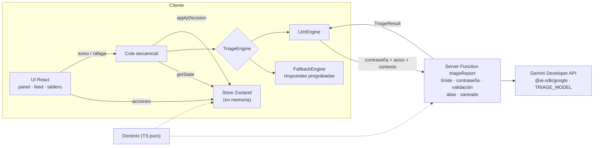
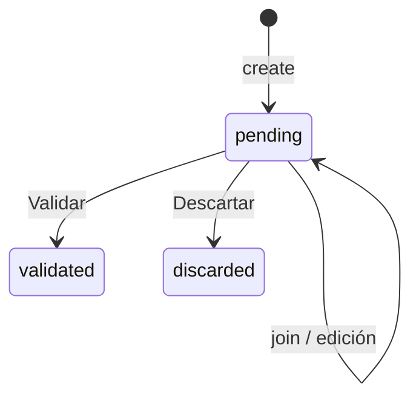

# EmergencyTriage

*   **Author:** JackElSimple
*   **Status:** Approved (diseño cerrado; la fase 0 está pendiente de autorización)
*   **Date:** 2026-11-18

--------------------------------------------------------------------------------

## Overview

EmergencyTriage es un prototipo de consola de operaciones para incidentes en edificios. Recibe avisos de texto libre, usa una IA para proponer cómo agruparlos en incidentes y deja que una persona responsable de seguridad valide o descarte cada incidente.

Es la entrega de una prueba técnica de un proceso de selección: 2 días, unas 24 horas de trabajo. Trabaja solo con datos ficticios y **no es un sistema real de gestión de emergencias**. Se presenta en directo en una entrevista técnica.

**Criterio de diseño.** La prioridad es un recorrido completo, desplegado y demostrable de principio a fin. Se prefiere una aplicación pequeña con limitaciones conocidas y documentadas antes que mecanismos que no lleguen a implementarse. Cada funcionalidad tiene que justificar su coste frente a lo que aporta a la demo.

El stack lo fija el enunciado: React, TypeScript, **TanStack Start con SSR**, shadcn/ui, Vercel AI SDK y Vercel AI Gateway, con despliegue en Vercel (plan Hobby). **Desviación deliberada:** la IA se llama directamente a la Gemini Developer API con `@ai-sdk/google`, sin AI Gateway (ver «Desviación del enunciado»). El objetivo de coste es 0 €. El código vive en este repositorio (`fusuma-test`).

### Relación con documentos anteriores

[`concepts_brief.md`](../../concepts_brief.md) y `design_draft.md` son históricos. **Este documento es la especificación vigente.** Cambios principales respecto al brief:

| Decisión vigente | Qué cambia |
|---|---|
| La IA recibe todos los incidentes del edificio con los textos completos de sus avisos. | Sustituye a la recomendación del brief de enviar solo un resumen compacto. |
| El estado vive **solo en memoria** del navegador. Una recarga empieza de cero. | Sustituye a la persistencia en `localStorage` del brief (no era requisito del enunciado). |
| Ante un error de la IA, el aviso queda en error con «Reintentar» manual. Sin reintentos automáticos. | Sustituye a la pausa corta con un reintento fijo del brief. |
| Mientras la cola procesa, no se puede reiniciar, cambiar de modo ni actuar sobre incidentes. | Nueva: evita gestionar cambios concurrentes del tablero. |
| La respuesta de la IA no tiene campo `confidence`. | Sustituye al esquema inicial del brief. |
| Se agrupa solo en el mismo edificio y la misma planta; otras plantas se relacionan. | Concreta la regla del brief. |
| Contraseña de demo compartida, validada en el servidor. | El brief la dejaba como opcional. |

### Desviación del enunciado: sin AI Gateway

El enunciado pide Vercel AI Gateway. **Este diseño se aparta de ese requisito de forma deliberada.**

- **Por qué:** en la fase 0, AI Gateway devolvió un 403 en sus 5 modelos de precio 0. Exige una tarjeta de crédito registrada para desbloquear los créditos gratuitos, y el objetivo de coste es 0 € sin tarjeta, sin planes y sin pagos.
- **Decisión del autor:** la IA se llama directamente a la Gemini Developer API con el proveedor oficial `@ai-sdk/google` del AI SDK, en su nivel gratuito. No se configura facturación de Google Cloud ni se contrata ningún plan.
- **Qué se mantiene:** React, TypeScript, TanStack Start con SSR, shadcn/ui, Vercel AI SDK y despliegue en Vercel.
- **Qué cambia:** el requisito 1 de los obligatorios queda cumplido salvo AI Gateway. Hay que decirlo en el README y en la entrevista, sin presentarlo como cumplido.
- **Coste de volver atrás:** pequeño. Solo `src/server/llm-client.ts` importa el AI SDK, y con el Gateway el modelo se indica con una cadena `proveedor/modelo`.
- **Configuración prevista (fase 2):**
  - paquete `@ai-sdk/google`, en una versión compatible con `ai` 7.0.176;
  - variable `GOOGLE_GENERATIVE_AI_API_KEY`, solo en el servidor;
  - un modelo Gemini del nivel gratuito, elegido tras comprobar su disponibilidad y su cuota;
  - `generateText` con `Output.object()` y `AiDecisionSchema`, `maxRetries: 0`, timeout de 15 s y la clasificación de errores ya definida.

## The Problem

Cuando pasa algo en un edificio, varios ocupantes avisan casi a la vez, y cada uno lo describe a su manera:

- «Huele a humo en la segunda planta».
- «Hay una especie de niebla gris en la planta 2».
- «Se percibe olor a quemado cerca de las escaleras».

La persona responsable de seguridad tiene que leerlo todo y deducir cuántos incidentes reales hay, dónde están, qué gravedad tienen y qué protocolo aplicar. Con una ráfaga de avisos mezclados entre edificios y plantas aparecen tres riesgos: tratar un incidente como si fueran varios, mezclar incidentes distintos y tardar demasiado en decidir.

### La solución propuesta

EmergencyTriage procesa los avisos de uno en uno. Para cada aviso, una IA **propone**:
- si pertenece a un incidente pendiente del mismo edificio y planta, o si abre uno nuevo;
- una categoría (existente o, como último recurso, una nueva no oficial);
- una gravedad (Baja, Media, Alta o Crítica);
- uno de 5 protocolos predefinidos;
- un resumen y una frase con el motivo.

La persona responsable ve en una sola pantalla los avisos y las tarjetas de incidente. Puede corregir cualquier campo de un incidente pendiente y después **validarlo** (aprueba la propuesta de protocolo; en la demo no se ejecuta nada) o **descartarlo** (por ejemplo, una falsa alarma). Un incidente validado o descartado ya no cambia.

La IA no decide, solo propone. El código garantiza que **ninguna referencia inventada** (incidente, categoría o protocolo) llega al estado, y que las ubicaciones, rutas y puntos de reunión **del bloque de protocolo** de la tarjeta salen solo de los datos maestros. El resumen y el motivo son texto libre de la IA, no se verifican y se muestran como «Texto generado por IA».

### A quién sirve

- **Usuario del producto:** la persona responsable de seguridad que mira el tablero. En la demo, una misma persona hace también de ocupante desde el formulario lateral.
- **Público de la demo:** el equipo evaluador de la prueba técnica.

## Goals

### Requisitos obligatorios (enunciado)

1. Stack: React, TypeScript, TanStack Start con SSR, shadcn/ui, AI SDK y despliegue en Vercel con una URL pública. **AI Gateway queda fuera por decisión del autor** (ver «Desviación del enunciado»).
2. Recepción manual de avisos (edificio, planta, texto) y simulación de una ráfaga de avisos ficticios.
3. Análisis con IA: clasificación, gravedad, agrupación semántica, resumen y protocolo recomendado.
4. Categorías nuevas propuestas por la IA con aprobación humana.
5. Tablero de incidentes con intervención humana: corregir, validar o descartar.
6. Botón para reiniciar la demo.

### Funcionalidades esenciales del MVP

1. **Recorrido de la ráfaga.** «Simular ráfaga» encola 9 avisos del guion, que se procesan de uno en uno y terminan en las agrupaciones de la tabla «Guion de la ráfaga». Antes de la entrevista se comprueba a mano con el modo sin API y, si la fase 2 consiguió una llamada real con un modelo Gemini gratuito, con la IA real. No es una evaluación estadística del modelo.
2. **Ninguna referencia inventada llega al estado.** Los alias que la IA no recibió se descartan o producen un error; un incidente no elegible nunca recibe el aviso.
3. **La persona tiene la última palabra.** Un campo editado a mano queda bloqueado frente a la IA; la IA nunca baja la gravedad de un incidente; solo una persona valida o descarta.
4. **Modo sin API determinista.** Seleccionable con el tablero vacío; reproduce la ráfaga con 9 respuestas pregrabadas y siempre da el mismo resultado.
5. **Errores visibles y recuperables a mano.** Un error de la IA deja el aviso marcado con su tipo y un botón «Reintentar»; la cola sigue con el siguiente.
6. **Coste 0 € y claves protegidas.** El nivel gratuito de la Gemini Developer API (se comprueba su disponibilidad y su cuota en la fase 2; sin facturación de Google Cloud, sin planes y sin pagos) y Vercel Hobby. `GOOGLE_GENERATIVE_AI_API_KEY` solo existe en el servidor; las llamadas a la IA exigen una contraseña de demo.
7. **Arquitectura explicable.** Reglas de negocio en funciones de TypeScript puro con tests; el motor de IA y el modo sin API implementan la misma interfaz; README con diagramas.

### Guion de la ráfaga: agrupaciones esperadas

9 avisos que deben terminar en **5 incidentes**. Los textos, la rúbrica de gravedad y los resultados detallados están en el archivo 9 del Detailed Implementation Plan.

| Grupo | Edificio y planta | Avisos | Caso que demuestra |
|---|---|---|---|
| A: humo | Torre Central, planta 2 | S1, S2, S4, S7 | Textos distintos se agrupan; la gravedad sube. |
| B: humo en la escalera | Torre Central, planta 3 | S6 | Mismo fenómeno en otra planta: incidente nuevo **relacionado** con A. |
| C: persona desmayada | Torre Central, planta 2 | S8 | Misma planta que A pero otro suceso: incidente nuevo **sin** relación. |
| D: fallo eléctrico | Edificio Anexo A, planta 0 | S3, S5 | Agrupación en otro edificio, intercalada con A. |
| E: agua cayendo del techo | Laboratorios, planta -1 | S9 | Ninguna categoría encaja: la IA crea una categoría no oficial. |

### Mejoras opcionales (solo si sobra margen, en este orden)

1. Indicador «N avisos nuevos desde tu edición» en el resumen bloqueado.
2. Script `check-burst` que ejecuta la ráfaga contra el modelo real en Node y compara con la tabla.
3. Persistencia en `localStorage` (sin SSR del tablero).
4. Toast al crear una categoría nueva (la insignia «No oficial» ya es esencial).

## Non-Goals

- **No es un sistema de emergencias real.** No ejecuta protocolos ni envía notificaciones.
- **Sin recuperación automática:** ni reintentos automáticos, ni pausa por 429, ni cambio automático al modo sin API, ni respaldo por aviso.
- **Sin persistencia:** el estado vive en memoria; una recarga empieza de cero.
- **Sin acciones concurrentes:** mientras la cola procesa no se puede reiniciar, cambiar de modo, editar, validar, descartar ni aprobar categorías.
- **Sin fusión manual ni «Separar aviso».** Una agrupación errónea se corrige descartando el incidente.
- **Sin agrupación entre plantas** ni incidentes con varias plantas.
- **Sin estado `Resuelto`.** `Validado` significa «propuesta aprobada».
- **Sin creación ni borrado de categorías a mano.** «Cambiar categoría» elige entre las existentes.
- **Sin AI Gateway** (desviación deliberada del enunciado; ver «Desviación del enunciado»).
- **Sin base de datos, varios usuarios, cuentas, vista móvil, audio, event sourcing ni arrastrar tarjetas.**

## Open Questions

Ninguna que bloquee el MVP. La pregunta de producción (dónde serializar el procesamiento con varios operadores) está en Future Improvements.

## Critical User Journeys (CUJs)

### CUJ 1: La ráfaga se consolida en directo

*   **Given**: tablero vacío, modo IA, contraseña de demo introducida.
*   **When**: el operador pulsa «Simular ráfaga».
*   **Then**:
    *   los 9 avisos entran en el feed como «En cola» y se procesan de uno en uno («Procesando», «Asignado a INC-n»);
    *   las tarjetas se crean o se actualizan después de cada aviso;
    *   mientras la cola procesa, «Reiniciar», el cambio de modo y las acciones de las tarjetas están desactivados;
    *   el tablero termina con los incidentes del guion, según el criterio de coincidencia del archivo 9, todos en `Pendiente`.

### CUJ 2: Un aviso manual se agrupa

*   **Given**: un incidente `Pendiente` de humo en Torre Central, planta 2.
*   **When**: el operador envía «Olor a quemado junto a la escalera» para Torre Central, planta 2.
*   **Then**:
    *   el aviso queda asignado a ese incidente;
    *   el contador sube, el resumen se actualiza si no está bloqueado y la gravedad se mantiene o sube.

### CUJ 3: Un aviso de otra planta se relaciona

*   **Given**: un incidente `Pendiente` de humo en Torre Central, planta 2.
*   **When**: llega «Hay humo saliendo del hueco de la escalera» para la planta 3.
*   **Then**:
    *   se crea un incidente nuevo en la planta 3;
    *   su tarjeta muestra «Relacionado con INC-n».

### CUJ 4: El operador corrige y valida

*   **Given**: un incidente `Pendiente`, cola parada.
*   **When**: el operador cambia el protocolo y pulsa «Validar».
*   **Then**:
    *   el protocolo queda bloqueado al editarlo;
    *   la tarjeta pasa a `Validado`, muestra «Protocolo aprobado (no ejecutado: demo)» y ya no se puede editar;
    *   un aviso posterior sobre el mismo hecho crea un incidente nuevo relacionado con este.

### CUJ 5: El operador descarta una falsa alarma

*   **Given**: un incidente `Pendiente`, cola parada.
*   **When**: el operador pulsa «Descartar».
*   **Then**:
    *   la tarjeta pasa a `Descartado` y queda inmutable.

### CUJ 6: La IA crea una categoría y el operador la aprueba

*   **Given**: llega un aviso que no encaja en ninguna categoría.
*   **When**: la IA crea la categoría no oficial «Fuga de agua» y, con la cola parada, el operador pulsa «Aprobar categoría».
*   **Then**:
    *   la categoría pasa a oficial;
    *   ninguna tarjeta que la use vuelve a mostrar «Aprobar categoría».

### CUJ 7: La IA falla y el operador reintenta

*   **Given**: modo IA; la IA devuelve un error (por ejemplo, 429 o timeout) en un aviso.
*   **When**: la cola recibe el error.
*   **Then**:
    *   el aviso queda como «Error: <tipo>» con «Reintentar» (salvo `invalid_input`, que no se puede reintentar);
    *   la cola sigue con el siguiente aviso;
    *   al pulsar «Reintentar», el aviso vuelve al final de la cola y se procesa con el estado actual.

### CUJ 8: Demo sin API

*   **Given**: tablero vacío y cola parada.
*   **When**: el operador activa «Modo sin API» y pulsa «Simular ráfaga».
*   **Then**:
    *   la ráfaga se procesa con respuestas pregrabadas, sin llamadas a la IA ni contraseña;
    *   el resultado coincide exactamente con la tabla del guion;
    *   la cabecera indica «Modo: Sin API»;
    *   el formulario manual está desactivado, porque solo hay respuestas pregrabadas para los 9 avisos del guion.

### CUJ 9: Contraseña de demo

*   **Given**: modo IA, sin contraseña en esta sesión.
*   **When**: el operador envía un aviso o pulsa «Simular ráfaga».
*   **Then**:
    *   antes de la primera llamada se abre el diálogo de contraseña y los avisos siguen «En cola»;
    *   si el servidor la rechaza, el aviso vuelve a la cola en su misma posición, la cola se detiene y el diálogo se abre con «Contraseña incorrecta»;
    *   con la contraseña correcta, la cola continúa sin haber perdido ningún aviso;
    *   el diálogo no se puede cerrar sin introducir una contraseña. Para salir sin introducirla se recarga la página, que equivale a reiniciar la demo porque el estado solo está en memoria.

## Technical Plan (Architecture)

### Resumen

Tres partes:

1. **Cliente.** React para la interfaz, un store de Zustand con el estado en memoria y una cola que procesa los avisos de uno en uno.
2. **Servidor.** Una Server Function de TanStack Start, sin estado, que llama a la Gemini Developer API con el AI SDK y `@ai-sdk/google`, valida la respuesta y devuelve una decisión con IDs reales o un error tipado.
3. **Dominio.** Tipos y reglas en TypeScript puro, sin React ni AI SDK. Lo usan el cliente, el servidor y los tests.

Flujo de un aviso:
1. La cola toma el primer aviso en cola y construye su contexto con el estado actual.
2. El motor activo devuelve una decisión: en modo IA, a través de la Server Function; en modo sin API, desde las respuestas pregrabadas.
3. La cola aplica la decisión con `applyDecision`, que es **la única comprobación que manda** sobre qué cambia en el estado.

**SSR.** Lo exige el enunciado. El servidor pinta la página completa con el estado inicial (tablero vacío y datos maestros). Como no hay persistencia, el estado inicial es el mismo en el servidor y en el cliente, así que no hay diferencias de hidratación ni hace falta `ClientOnly`. El store nunca se modifica en el servidor: sus acciones solo se ejecutan por interacción del usuario en el navegador.



### 1. Datos maestros

Constantes de TypeScript:
- **Edificios:** `{ id, name, floors }`. Torre Central (−2 a 8), Edificio Anexo A (−1 a 3), Laboratorios (−1 a 2).
- **Protocolos:** 5 entradas `{ id, title }` con un texto ficticio por edificio («[FICTICIO]», sin validez operativa). La tarjeta muestra ese texto; la IA solo elige el `id`.
- **Categorías iniciales:** Incendio/Humo, Fallo Eléctrico, Médico y Seguridad, oficiales.

### 2. Modelo de datos

```text
Severity        = "low" | "medium" | "high" | "critical"     // low < medium < high < critical
IncidentState   = "pending" | "validated" | "discarded"
Mode            = "llm" | "fallback"
ReportErrorKind = "rate_limit" | "timeout" | "invalid_input" | "invalid_output"
                | "invalid_ref" | "network" | "server"
TriageErrorKind = ReportErrorKind | "unauthorized"   // unauthorized nunca se guarda en un aviso

Report {
  id: string
  seq: number                   // orden de cola, feed y lista de avisos; «Reintentar» asigna uno nuevo (al final)
  buildingId: string
  floor: number
  text: string                  // 1..500 caracteres
  createdAt: number             // solo para mostrar la hora
  status: "queued" | "processing" | "done" | "error"
  errorKind: ReportErrorKind | null
  incidentId: string | null     // ÚNICA relación aviso→incidente
  scriptKey: string | null      // "S1".."S9" si viene de la ráfaga
}

Incident {
  id: string
  number: number                // etiqueta estable «INC-n», asignada al crearlo
  buildingId: string
  floor: number                 // la del primer aviso; no cambia
  categoryId: string
  severity: Severity
  protocolId: string
  summary: string               // ≤ 300
  rationale: string             // ≤ 200; motivo de la última propuesta aplicada
  state: IncidentState
  relatedIncidentId: string | null
  locks: { category, severity, protocol, summary: boolean }
}

Category { id: string, name: string /* ≤ 40 */, official: boolean }

TriageState {
  mode: Mode
  nextSeq: number
  nextIncidentNumber: number
  burstStartSeq: number | null  // seq del primer aviso de la última ráfaga (progreso «n/9»)
  reports: Record<id, Report>
  incidents: Record<id, Incident>
  categories: Record<id, Category>
}
```

**Datos derivados** (selectores, no se guardan):
- `reportsOf(incident)`: avisos con `incidentId === incident.id`, por `seq`; de ahí el contador y la hora del último aviso.
- `queueOrder`: avisos `queued` por `seq`.
- `visibleCategories`: oficiales más las no oficiales que usa algún incidente.
- `isBoardEmpty`: no hay ningún aviso.
- `burstProgress`: avisos con `scriptKey` y `seq ≥ burstStartSeq` que ya no están en cola ni procesándose, sobre 9.

### 3. Reglas del dominio

**Invariantes** (cada una con su test o cubierta por un test de `applyDecision`):
1. `report.incidentId` es la única relación aviso-incidente. El incidente no guarda lista ni contador.
2. Un incidente se crea en la misma operación que asigna su primer aviso.
3. Todos los avisos de un incidente tienen su edificio y su planta.
4. Un incidente `validated` o `discarded` no cambia. Aprobar una categoría cambia el catálogo, no los incidentes.
5. Un campo bloqueado no lo cambia la IA. La IA nunca baja la gravedad de un incidente; una persona sí, y el campo queda bloqueado.
6. Toda `categoryId`, `protocolId` y `relatedIncidentId` apunta a un registro existente. Las categorías solo desaparecen con «Reiniciar demo».

**Política de agrupación** (va en el prompt):
1. Mismo edificio y misma planta es **necesario**, no suficiente.
2. Además, los avisos deben describir **el mismo suceso** o fenómenos directamente relacionados con él.
3. **Ante la duda, separar:** crear un incidente nuevo. Una agrupación errónea no se puede deshacer; una separación innecesaria cuesta una tarjeta de más.
4. **Relacionar no es agrupar:** se relaciona el mismo fenómeno en otra planta o información nueva sobre un incidente validado.

**Elegibilidad.** Dos funciones puras, `canJoin(incident, report)` y `canRelate(incident, report)`. El servidor las usa para marcar en el prompt qué incidentes se pueden usar; `applyDecision` las aplica con el estado actual y es la comprobación que manda. No son una frontera de seguridad: el servidor calcula los indicadores con datos que envía el cliente.

| Incidente | `canJoin` | `canRelate` |
|---|---|---|
| `pending`, misma planta | sí | no |
| `pending`, otra planta del edificio | no | sí |
| `validated`, cualquier planta del edificio | no | sí |
| `discarded` | no | no |

Que un incidente `pending` de la misma planta no se pueda relacionar impide relacionar por código dos sucesos distintos de esa planta. Frente a un incidente `validated` de la misma planta, evitar una relación entre sucesos distintos depende del prompt.

### 4. Contrato con la IA

La IA recibe alias cortos (I1…, C1…, P1…P5), nunca IDs reales, y devuelve un objeto plano en el que todos los campos son obligatorios y «sin valor» es `null`:

```text
AiDecision {
  action: "join" | "create"
  targetRef: string | null        // I1..; obligatorio con join; se ignora con create
  relatedRef: string | null       // I1..; solo se usa con create
  categoryRef: string | null      // C1..
  newCategoryName: string | null  // ≤ 40; solo si ninguna categoría encaja
  severity: Severity
  protocolRef: string             // P1..P5
  summary: string                 // ≤ 300
  rationale: string               // ≤ 200
}
```

Reglas entre campos (si no se cumplen, `invalid_output`): `join` exige `targetRef`; exactamente uno de `categoryRef` o `newCategoryName`.

**Contexto por aviso:** el aviso nuevo; todos los incidentes del mismo edificio, con sus campos, los textos completos de sus avisos y los indicadores `canJoin`/`canRelate`; el catálogo de categorías completo; y los 5 protocolos con su texto para el edificio. Límites: 30 incidentes, 150 avisos de contexto y 128 KB por petición.

**Prompt** (en español, versionado con `PROMPT_VERSION`), en siete partes:
1. rol: «propones, no decides»;
2. política de agrupación;
3. prohibición de inventar ubicaciones, rutas, instrucciones o referencias, también en el texto libre;
4. reglas de gravedad y rúbrica ficticia de la demo;
5. categoría: solo vale si su nombre describe el tipo de suceso (la causa, no sus efectos); no se elige la más cercana por aproximación y, si ninguna describe el suceso, se propone una nueva, pensada para el incidente en su conjunto. El motivo dice qué suceso se identificó;
6. un ejemplo resuelto de agrupación;
7. un ejemplo negativo: dos sucesos independientes en la misma planta y con pocos minutos de diferencia no se agrupan.

El texto de los avisos va entre delimitadores y se declara como dato, no como instrucción.

### 5. Server Function `triageReport`

Creada con `createServerFn({ method: 'POST' })`. Con GET, el método por defecto, el contexto y la contraseña viajarían en la URL. Tiene un `maxDuration` de 30 s, configurado como indica la guía oficial (ver «Decisiones de API fijadas»), y no guarda estado salvo el contador del límite. Pasos:

1. **Límite de peticiones:** contador en memoria por instancia, 20 por minuto, contando también los intentos con contraseña incorrecta. Si se supera, `rate_limit`.
2. **Contraseña:** se calcula el SHA-256 de la entrada y el de `DEMO_PASSWORD`, y los dos resultados se comparan con `timingSafeEqual` de `node:crypto`. Como siempre miden 32 bytes, la comparación nunca lanza una excepción. Si la variable falta o tiene menos de 12 caracteres, `server` (error de configuración, no de contraseña). Si no coincide, espera 1 s y devuelve `unauthorized`.
3. **Validación de entrada** con `safeParse` de Zod dentro de la función (textos, edificio y planta existentes, todos los incidentes del mismo edificio, límites de tamaño). Si falla, `invalid_input`. No se usa un validador de Zod en la propia Server Function, porque una entrada no válida lanzaría una excepción en lugar de devolver `invalid_input`.
4. **Elegibilidad y alias:** calcula `canJoin`/`canRelate` y asigna alias.
5. **Llamada a la IA:**
   - `TRIAGE_MODEL`, con el ID fijado en la fase 0;
   - temperatura 0 y como máximo 800 tokens de salida;
   - `maxRetries: 0`, sin reintentos del SDK;
   - `abortSignal: AbortSignal.timeout(15_000)`;
   - razonamiento extendido según «Decisiones de API fijadas».
6. **Validación de la salida** con Zod y las reglas entre campos. Si falla, `invalid_output`. El esquema que recibe el SDK no limita la longitud de los textos; esos límites los aplica el recorte del paso 7.
7. **Traducción y saneado de referencias:**
   - `targetRef` desconocido → `targetIncidentId: null` (`applyDecision` lo convertirá en «crear»);
   - `relatedRef` desconocido → `null`;
   - `categoryRef` o `protocolRef` desconocidos → `invalid_ref`;
   - `newCategoryName` que, normalizado (minúsculas, sin tildes, espacios simples), coincide con una categoría existente → esa categoría;
   - textos recortados a su máximo.
8. **Errores**, comprobados en este orden:
   1. un aborto o un timeout da `timeout`;
   2. un error de la API con estado 429 da `rate_limit`;
   3. un error del SDK porque la salida no cumple el esquema da `invalid_output`;
   4. cualquier otro error da `server`.

   La función nunca lanza excepciones al cliente.
9. **Log:** una línea por llamada con `{ model, promptVersion, latencyMs, tokens, outcome }`.

```text
TriageResult = { ok: true, decision: TriageDecision } | { ok: false, error: TriageErrorKind }

TriageDecision {        // IDs reales
  action: "join" | "create"
  targetIncidentId: string | null
  relatedIncidentId: string | null
  category: { existingId } | { newName }
  severity, protocolId, summary, rationale
}
```

### 6. Motores

```text
interface TriageEngine { propose(input: TriageInput): Promise<TriageResult> }
TriageInput { report, contextIncidents: { incident, reports[] }[], categories }
```

- **`LlmEngine`:** llama a `triageReport` con la contraseña en memoria; un fallo de red es `network`.
- **`FallbackEngine`:** devuelve la respuesta pregrabada de `report.scriptKey` tras unos 600 ms. Las respuestas no usan IDs, sino el **aviso ancla** del grupo («unirse al incidente del aviso S1»), que se traduce al `incidentId` actual de ese aviso. Como el modo sin API solo procesa una ráfaga sobre un tablero vacío y nunca falla, cada ancla existe y es única. Si un ancla no tuviera incidente, el destino sería `null` y `applyDecision` lo trataría como «crear».

### 7. `applyDecision` y acciones

`applyDecision(state, { reportId, decision, newIncidentId, newCategoryId }) → { state, createdCategory }`. Es una función pura: los IDs nuevos llegan como datos y los números (`seq`, `INC-n`) salen de los contadores del estado.

1. Si el aviso no existe o no está `processing`, no cambia nada.
2. **`join` a un destino con `canJoin`:**
   - el aviso se asigna al destino;
   - el resumen, el protocolo y la categoría se actualizan si no están bloqueados (si la categoría está bloqueada, una categoría nueva propuesta no se crea);
   - `severity = max(actual, propuesta)` si no está bloqueada;
   - `rationale` se actualiza siempre;
   - **la relación del destino no cambia.**
3. **`join` sin destino válido** (alias desconocido o incidente sin `canJoin`): se crea un incidente nuevo. Su resumen es el texto del aviso (recortado a 300), su gravedad la propuesta y su motivo «Incidente nuevo: el incidente propuesto no admitía este aviso.». Queda relacionado con el destino si este existe y tiene `canRelate`.
4. **`create`:** incidente nuevo con `number = nextIncidentNumber`, estado `pending`, sin bloqueos y con el edificio y la planta del aviso. La relación propuesta se guarda si el incidente existe y tiene `canRelate`.
5. **Categoría nueva:** si el nombre normalizado ya existe, se reutiliza; si no, se crea no oficial y se devuelve como `createdCategory`.
6. El aviso pasa a `done`.

Si la categoría existente o el protocolo de la decisión no existen, `applyDecision` lanza un error. El servidor lo impide con `invalid_ref`, así que es un error de programación, y la cola lo convierte en un error `server` del aviso (`drain()`, paso con `catch`).

**Acciones del operador** (solo sobre incidentes `pending`): `editIncident` (cada campo editado queda bloqueado; la categoría se elige entre `visibleCategories`), `validateIncident` y `discardIncident`. **Sobre el catálogo:** `approveCategory`, visible en cualquier columna. **Sobre avisos:** `enqueueReports`, `markProcessing`, `markError`, `retryReport` (vuelve a la cola con un `seq` nuevo, al final) y `returnToQueue` (vuelve a la cola conservando su `seq`). **Reinicio:** `createInitialState(mode)`. Conserva el modo actual. El store conserva además `demoPassword` y pone `passwordPrompt ← null`.



### 8. Store y cola

**Store de Zustand**, sin persistencia. Guarda `TriageState` y tres campos de interfaz: `running` (la cola está procesando), `demoPassword` (solo en memoria) y `passwordPrompt` (`null` o `{ rejected: boolean }`). Las acciones del store llaman a las funciones del dominio.

**Cola** (módulo TypeScript sin React, con el store y los motores inyectados para poder testearla):

```text
drain():
  si running: salir                 // el bucle en curso recogerá los avisos nuevos
  running ← true
  try:
    mientras queueOrder no esté vacío:
      s ← getState();  report ← primero de queueOrder(s)
      si s.mode = "llm" y no hay demoPassword:
          passwordPrompt ← { rejected: false };  salir del bucle
      markProcessing(report)
      try:
          result ← motor(s.mode).propose(buildTriageInput(getState(), report.id))
          si result.ok:
              { state, createdCategory } ← applyDecision(getState(), { reportId: report.id,
                  decision: result.decision, newIncidentId: uuid(), newCategoryId: uuid() })
              setState(state)
          si no, si result.error = "unauthorized":
              returnToQueue(report);  demoPassword ← null
              passwordPrompt ← { rejected: true };  salir del bucle
          si no:
              markError(report, result.error)    // la cola sigue
      catch:
          markError(report, "server")            // un fallo del cliente no deja el aviso en «Procesando»
      si report.scriptKey: esperar 300 ms
  finally:
    running ← false
```

- Un aviso encolado mientras `running` está activo lo recoge el bucle en curso: entre la última comprobación y el `finally` no hay ningún `await`.
- **Mientras `running` es verdadero**, la interfaz desactiva «Reiniciar», el interruptor de modo, «Simular ráfaga», «Editar», «Validar», «Descartar» y «Aprobar categoría». Siguen activos «Enviar aviso» y «Reintentar», que solo añaden avisos a la cola. Así el tablero no cambia por acciones del operador durante una llamada.
- Al introducir la contraseña: se guarda, `passwordPrompt ← null` y `drain()`.
- El diálogo de contraseña no se puede cerrar sin introducirla (ver CUJ 9).

### 9. Interfaz

Una ruta (`/`), componentes de shadcn/ui:

- **Cabecera:** nombre, «Demo con datos ficticios» y «Modo: IA / Sin API».
- **Panel lateral:**
  - formulario (edificio, planta, texto con contador de 500; desactivado en modo sin API);
  - «Simular ráfaga» (en modo sin API, solo con el tablero vacío);
  - «Reiniciar demo» con confirmación;
  - interruptor «Modo sin API» (solo con el tablero vacío y la cola parada);
  - progreso «n/9».
- **Feed:** avisos del más reciente al más antiguo, con edificio, planta, hora, texto, estado («En cola», «Procesando», «Asignado a INC-n», «Error: …») y «Reintentar» si procede.
- **Tablero:** columnas `Pendiente | Validado | Descartado`. Cada tarjeta muestra:
  - `INC-n`, categoría (con «No oficial» y «Aprobar categoría» si procede), gravedad con color, edificio y planta;
  - el protocolo con su texto «[FICTICIO]»;
  - resumen y motivo bajo «Texto generado por IA»;
  - número de avisos, hora del último aviso y «Relacionado con INC-m»;
  - un candado en los campos bloqueados;
  - en `Pendiente`: «Editar», «Validar», «Descartar». En `Validado`: «Protocolo aprobado (no ejecutado: demo)».
- **Diálogos:** edición del incidente y contraseña.

## Alternatives Considered

#### Alternative A: Reagrupar todos los avisos en bloque

*   **Pros**: la IA podría corregir agrupaciones anteriores.
*   **Cons**: IDs inestables mientras el operador mira; coste creciente por llamada.
*   **Reason for Rejection**: Rejected by author: la agrupación incremental mantiene incidentes estables y un coste lineal.

#### Alternative B: Procesar avisos en paralelo

*   **Pros**: ráfaga más rápida.
*   **Cons**: dos avisos del mismo suceso se evalúan sin verse y duplican incidentes.
*   **Reason for Rejection**: Rejected by author: la cola secuencial evalúa cada aviso con el estado que dejó el anterior.

#### Alternative C: Agrupar plantas contiguas o incidentes con varias plantas

*   **Pros**: un incendio que sube quedaría en una tarjeta.
*   **Cons**: regla arbitraria y más difícil de comprobar; esquema más complejo.
*   **Reason for Rejection**: Rejected by author: «misma planta» se comprueba por código en una línea; la propagación se expresa con relaciones.

#### Alternative D: Persistencia en `localStorage`

*   **Pros**: el tablero sobrevive a una recarga.
*   **Cons**: con SSR obliga a desactivar la hidratación automática, renderizar el tablero solo en el cliente, versionar el estado y tratar los avisos interrumpidos.
*   **Reason for Rejection**: Rejected by author: no es un requisito; en una demo de una sola sesión, su coste no compensa. Queda como mejora opcional.

#### Alternative E: Estado en el servidor o base de datos

*   **Pros**: estado compartido y más cercano a producción.
*   **Cons**: las funciones serverless no comparten memoria; una base de datos añade infraestructura.
*   **Reason for Rejection**: Rejected by author: fuera del MVP; está en Future Improvements.

#### Alternative F: `useReducer` + Context en lugar de Zustand

*   **Pros**: sin dependencias.
*   **Cons**: la cola, que vive fuera de React, necesitaría una `ref` mantenida a mano para leer el estado actual.
*   **Reason for Rejection**: Rejected by author: con Zustand la cola lee el estado con `getState()`.

#### Alternative G: Recuperación automática de errores

*   **Pros**: una ráfaga con errores transitorios terminaría sola (pausa por 429, reintentos, cambio automático al modo sin API).
*   **Cons**: varios estados y caminos de espera nuevos, con interacciones difíciles con el reinicio; la primera revisión encontró defectos en ellos.
*   **Reason for Rejection**: Rejected by author: el error queda visible con «Reintentar» manual y el modo sin API se elige antes de la ráfaga.

#### Alternative H: Contexto compacto para la IA

*   **Pros**: menos tokens.
*   **Cons**: la IA dependería de resúmenes que pueden estar bloqueados o desactualizados.
*   **Reason for Rejection**: Rejected by author: con el volumen de la demo, enviar los avisos completos cuesta poco y mejora la agrupación.

#### Alternative I: Esquema de respuesta como unión de tipos

*   **Pros**: tipos más precisos.
*   **Cons**: si la salida estructurada del proveedor no admite uniones, la validación fallaría.
*   **Reason for Rejection**: Rejected by author: un objeto plano con `null` funciona con más proveedores; se comprueba en la fase 0, con `AiDecisionSchema` real.

#### Alternative J: Categorías «Otro» y «Falsa Alarma»

*   **Pros**: lista cerrada.
*   **Cons**: «Otro» esconde información; «Falsa Alarma» mezcla el tipo de suceso con su veracidad.
*   **Reason for Rejection**: Rejected by author: categorías dinámicas con aprobación; una falsa alarma se descarta.

#### Alternative K: Fusión manual, «Separar aviso», arrastrar tarjetas o vista de arquitectura en la app

*   **Pros**: más control y una demo más vistosa.
*   **Cons**: entre 1 y 3 h cada una.
*   **Reason for Rejection**: Rejected by author: no caben en 24 h; los botones y el README cubren la necesidad.

#### Alternative L: Vercel AI Gateway (lo que pide el enunciado)

*   **Pros**: cumple el enunciado; en Vercel se autentica por OIDC sin clave; cambiar de modelo es cambiar una cadena.
*   **Cons**: en la fase 0 devolvió un 403 en los 5 modelos de precio 0, porque exige una tarjeta registrada para desbloquear los créditos gratuitos. BYOK exige además un plan de pago.
*   **Reason for Rejection**: Rejected by author: el objetivo de coste es 0 € sin tarjeta, sin planes y sin pagos. Se usa la Gemini Developer API directamente con `@ai-sdk/google`. Es una desviación deliberada del enunciado (ver «Desviación del enunciado»).

#### Alternative M: SPA sin SSR

*   **Pros**: algo más simple.
*   **Cons**: no cumple el enunciado.
*   **Reason for Rejection**: Rejected by author: el SSR es obligatorio; sin persistencia, no añade complejidad de hidratación.

--------------------------------------------------------------------------------

## Risks & Mitigations

| # | Riesgo | Mitigación | Limitación aceptada |
|---|---|---|---|
| R1 | El modelo se desvía del guion en directo (por ejemplo, agrupa S8 con A). | Prompt con ejemplo negativo; ID de modelo fijado en la fase 0; la ráfaga se prueba varias veces antes de la entrevista; el modo sin API reproduce el guion. | Con la IA real no hay garantía de resultado. Si diverge, se usa para enseñar por qué una persona valida. |
| R2 | El nivel gratuito de Gemini no está disponible para el modelo elegido, no admite la salida estructurada o su cuota (por minuto o por día) se agota. | La fase 2 comprueba disponibilidad y cuota antes de fijar `TRIAGE_MODEL` y registra el resultado. Sin facturación, planes ni pagos. Si no hay modelo gratuito que funcione, la demo usa el modo sin API. | Según las condiciones del nivel gratuito, Google puede usar los datos enviados (a verificar en la fase 2); solo se envían datos ficticios. El modo sin API cubre la ráfaga pregrabada, la gestión de incidentes (editar, validar, descartar), la aprobación de categorías y el reinicio. **No cubre** los avisos manuales ni el análisis con IA. |
| R3 | Errores de la IA en mitad de la ráfaga (429, timeout). | Error visible por aviso y «Reintentar». Se espera 1 minuto entre ráfagas reales seguidas para no superar el límite de 20 peticiones por minuto. | Varios avisos pueden quedar en error; reintentarlos cambia el orden y el resultado puede no coincidir con el guion. |
| R4 | Una agrupación errónea no se puede deshacer. | «Ante la duda, separar»; el motivo de cada propuesta es visible. | Corregirla exige descartar el incidente. |
| R5 | El texto libre de la IA inventa ubicaciones o instrucciones. | Prohibido en el prompt; etiqueta «Texto generado por IA»; el bloque de protocolo sale de los datos maestros. | El texto libre no se verifica. |
| R6 | Abuso de la URL pública. | Contraseña de al menos 12 caracteres; límite de peticiones antes de la contraseña; 1 s de espera tras un fallo; límites de tamaño y tokens; se cambia la contraseña tras la entrevista. | El límite es por instancia y global: alguien con la URL puede agotar las 20 peticiones por minuto. |
| R7 | APIs de TanStack Start o AI SDK distintas de lo previsto. | La fase 0 despliega la plantilla oficial con una llamada real y anota las APIs reales en «Decisiones de API fijadas»; versiones exactas en `package.json`; un único archivo usa AI SDK. | — |
| R9 | La desviación respecto a AI Gateway penaliza la evaluación. | Documentada en «Desviación del enunciado», en el README y en el guion de la entrevista, con el motivo (el Gateway exige una tarjeta para los créditos gratuitos) y el coste de volver atrás. | Un requisito del enunciado queda sin cumplir. |
| R8 | Las 24 h no alcanzan. | Margen de 2,5 h; las mejoras opcionales solo entran con margen; orden de recorte: pulido visual, luego script de comprobación. | — |

**Limitaciones conocidas** (documentadas en el README, sin código para evitarlas):
- Una recarga del navegador borra el tablero.
- Durante el procesamiento (unos 40 s en una ráfaga) el operador no puede actuar sobre los incidentes.
- Si un `join` apunta a un incidente no válido, el incidente nuevo usa la gravedad propuesta, que la IA pensó para el incidente consolidado.
- Un contexto por encima de los límites (30 incidentes, 150 avisos o 128 KB) devuelve `invalid_input` y no se puede reintentar. La demo está muy por debajo.
- Una sola sesión y un solo navegador.
- Sin un modelo elegible sin coste, la demo no enseña los avisos manuales ni el análisis con IA (R2).
- Entre dos ráfagas reales seguidas hay que esperar 1 minuto por el límite de peticiones.
- Para cerrar el diálogo de contraseña sin introducirla hay que recargar la página.

## Non-Functional Requirements

- **Seguridad:** `GOOGLE_GENERATIVE_AI_API_KEY` y `DEMO_PASSWORD` solo existen en el servidor (ninguna variable con prefijo `VITE_`); entrada validada con Zod; respuesta de la IA saneada; datos ficticios.
- **Rendimiento:** una llamada por aviso; ráfaga de unos 40 s con la IA real (medido en la fase 2: 41,5 s con `gemini-3.5-flash-lite`; cada llamada tarda entre 1 y 8 s, frente a un timeout de 15 s) y unos 8 s sin API. Estimación aproximada: 20.000-25.000 tokens de entrada por ráfaga.
- **Despliegue:** cada push a `main` despliega en Vercel; se vuelve atrás promoviendo el despliegue anterior.

## Future Improvements

- Estado en el servidor (Postgres o Redis) con una cola por edificio para varios operadores; con él, la elegibilidad pasaría a comprobarse con autoridad en el servidor.
- Persistencia, estado `Resuelto`, «Separar aviso» y registro de auditoría.
- Recuperación automática de errores y límite de peticiones compartido entre instancias.
- Migrar a Vercel AI Gateway (requisito del enunciado) cuando haya créditos disponibles, cambiando el proveedor en `src/server/llm-client.ts`.
- Vista móvil del ocupante, avisos por audio y evaluación formal de la agrupación.

--------------------------------------------------------------------------------

## Detailed Implementation Plan

### Fases y presupuesto (24 h)

| Fase | Contenido | Archivos | Horas | Condición de salida |
|---|---|---|---|---|
| 0. Esqueleto | Ver «Fase 0 en detalle». | 1 a 4, 37 y 38; versiones provisionales de 15 (solo `AiDecisionSchema`), 17, 18 (solo pasos 1, 2 y 5) y 24 (botón temporal) | 2,25 | Ver «Fase 0 en detalle». |
| 1. Dominio | Datos maestros, tipos, reglas, `applyDecision`, acciones y selectores. | 5 a 7, 10 a 14 y 39; tests 31 y 32 | 4 | Tests 31 y 32 en verde, y `npm run typecheck` sin errores. El archivo 39 (`vitest.config.ts`) hizo falta: Vitest falla al salir si carga los plugins de Start desde `vite.config.ts`. |
| 2. IA y servidor | Guion y rúbrica, contrato, alias, saneado, prompt y Server Function completa (pasos 1 a 9). Se instala `@ai-sdk/google`, se configura `GOOGLE_GENERATIVE_AI_API_KEY` (solo servidor) y se comprueban la disponibilidad y la cuota del modelo Gemini gratuito. | 9 y 15 a 18; test 33 | 2,75 | Test 33 en verde. Si hay un modelo Gemini gratuito disponible, el botón temporal recibe una decisión traducida a IDs reales tras los pasos 1 a 9. Si no, se deja constancia y la demo usa el modo sin API. |
| 3. Store y cola | Motor de IA, store en memoria y cola. | 19, 21 y 22; test 35 | 1,5 | Test 35 en verde. |
| 4. Modo sin API | Respuestas pregrabadas y `FallbackEngine`. | 8 y 20; test 34 | 1,5 | Test 34 en verde. |
| 5. Interfaz | Panel, feed, tablero, tarjetas y diálogos. Se quita el botón temporal. | 23 a 30 | 6 | En local funcionan los CUJ de la tabla «CUJ por modo», cada uno en su modo. |
| 6. Ajuste del prompt | Ráfagas reales en la interfaz. Solo se modifica `src/ai/prompt.ts` (16), y cada cambio sube `PROMPT_VERSION`. Los archivos 8 y 9 no cambian. Si la fase 2 no consiguió una llamada real con un modelo Gemini gratuito, esta fase no se hace y sus horas pasan al margen. | 16 | 1,5 | Tres ráfagas reales, con 1 minuto de espera entre una y otra, cumplen el **criterio de coincidencia** (archivo 9). Si no se consigue en 1,5 h, se anota en «Limitaciones conocidas» del README y la ráfaga de la entrevista se hace sin API. |
| 7. Cierre | README, despliegue final, recorrido de los CUJ en la URL pública y ensayo. | 36 | 2 | En la URL pública funcionan los CUJ de la tabla «CUJ por modo» marcados para la URL pública. |
| Margen | Imprevistos y, si sobra, las mejoras opcionales de Goals, en su orden. | — | 2,5 | |
| **Total** | | | **24** | |

### Fase 0 en detalle

**Objetivo:** comprobar el primer día, sin gastar dinero, que el despliegue con SSR funciona y que la llamada a la IA funciona con el esquema real.

> **Resultado y cambio de proveedor.** Esta subsección describe la fase 0 tal como se planificó con AI Gateway. El despliegue, el SSR, las variables y `maxDuration` se comprobaron (ver el registro). La llamada real falló con un 403 del Gateway. Los puntos que dependían del Gateway (saldo, modelos elegibles, OIDC y respuesta del modelo) **pasan a la fase 2 con la Gemini Developer API**. Ver «Desviación del enunciado».

Pasos:
1. **Plantilla:**
   - se genera la plantilla oficial de TanStack Start en una carpeta temporal y se copia al repositorio, conservando `.gitignore` y `README.md` (archivos 4 y 36, que se modifican, no se crean);
   - se fijan versiones exactas;
   - se configura el alias `@/*` y se ejecuta `shadcn init`.
2. **Despliegue en Vercel:**
   - se sigue la guía oficial vigente de TanStack Start para Vercel con Nitro;
   - se configura `maxDuration` de 30 s donde indique la guía.
3. **Saldo y modelos (coste 0 €):**
   - en el panel de AI Gateway se comprueba el saldo gratuito disponible y qué modelos son elegibles para ese nivel;
   - se elige un modelo elegible que admita la salida estructurada prevista, a ser posible sin razonamiento extendido por defecto.
4. **Llamada temporal:**
   - se adelantan a esta fase `AiDecisionSchema` (archivo 15) y los pasos 1 (límite), 2 (contraseña) y 5 (llamada) de `triageReport` (archivo 18), para que la URL pública no gaste saldo sin contraseña;
   - un botón temporal en `src/routes/index.tsx` llama a `triageReport` con el aviso S1 y la contraseña.
5. **Registro:** se completa la tabla «Registro de la fase 0» de la subsección siguiente.

**Condición de salida** (deben cumplirse todos los puntos):
- `curl <URL pública>` devuelve HTML con el contenido de la página ya pintado, no un contenedor vacío.
- En Vercel están configuradas `TRIAGE_MODEL` y `DEMO_PASSWORD`. La autenticación con el Gateway es por OIDC, sin `AI_GATEWAY_API_KEY` en Vercel.
- El panel de Vercel muestra una duración máxima de 30 s para la función.
- Desde la URL pública, el botón temporal recibe una respuesta que pasa `AiDecisionSchema`, y la respuesta no llega truncada con el límite de 800 tokens.
- Están anotados el ID del modelo, la respuesta, los tokens y el coste de la llamada. *(No cumplido con el Gateway; se comprueba en la fase 2.)*

**Si no hay ningún modelo adecuado que funcione sin coste:**
- se anota el resultado en el registro y en las limitaciones del README;
- la demo usa el modo sin API, que cubre lo que dice R2: la ráfaga y la gestión de incidentes, pero no los avisos manuales ni el análisis con IA;
- no se hacen pagos, no se contrata ningún plan y no se cambia a BYOK;
- las fases 2 a 5 siguen igual, porque el código de IA se escribe y se prueba con tests, y la fase 6 no se hace.

### Decisiones de API fijadas

Estas decisiones son obligatorias.

Los nombres concretos de funciones y opciones que dependen de la versión no se inventan. Se toman de la documentación de la versión instalada en la fase 0 y se anotan en la tabla de registro. Si la fase 0 descubre una API distinta, se anota en esa tabla y prevalece sobre esta lista.

- **Server Function:**
  - `createServerFn({ method: 'POST' })`;
  - la entrada se valida con `safeParse` dentro de la función, sin validador de Zod en la propia Server Function;
  - nunca lanza excepciones al cliente: siempre devuelve un `TriageResult`.
- **Proveedor:**
  - Gemini Developer API con `@ai-sdk/google`, versión compatible con `ai` 7.0.176 (se anota en el registro);
  - clave en `GOOGLE_GENERATIVE_AI_API_KEY`, solo en el servidor;
  - el modelo se crea con el proveedor de Google en `src/server/llm-client.ts`, que sigue siendo el único archivo que importa el AI SDK;
  - ni facturación de Google Cloud ni planes ni pagos.
- **Llamada al modelo:**
  - la función de salida estructurada de la versión de `ai` instalada, con `AiDecisionSchema` como esquema;
  - temperatura 0;
  - límite de 800 tokens de salida, con el nombre de opción de esa versión;
  - `maxRetries: 0`;
  - `abortSignal: AbortSignal.timeout(15_000)`.
- **Esquema que recibe el SDK:** sin límites de longitud en los textos; el recorte lo hace el paso 7.
- **Clasificación de errores** (en este orden):
  1. aborto o timeout → `timeout`;
  2. error de la API con estado 429 → `rate_limit`;
  3. error del SDK porque la salida no cumple el esquema → `invalid_output`;
  4. cualquier otro → `server`.

  Cada caso se reconoce con los comprobadores de tipo que exporte la versión instalada, y se anotan en la tabla de registro.
- **Contraseña:** SHA-256 (`createHash` de `node:crypto`) de la entrada y de `DEMO_PASSWORD`, comparados con `timingSafeEqual`.
- **Razonamiento extendido:**
  - si el modelo elegido razona por defecto, se desactiva o se reduce al mínimo con la opción que documente su proveedor para la versión instalada;
  - si no se puede y la respuesta llega truncada, se elige otro modelo elegible.
- **Versiones:**
  - exactas en `package.json`, sin `^` ni `~`;
  - `zod` con la versión mayor que acepte la versión instalada de `ai`, importado desde `"zod"`.
- **Despliegue:**
  - adaptador y `maxDuration` según la guía oficial de TanStack Start para Vercel con Nitro;
  - la duración efectiva se comprueba en el panel de Vercel.

**Registro de la fase 0** (se rellena durante la fase 0):

| Dato | Valor |
|---|---|
| Versiones de `@tanstack/react-start`, `ai` y `zod` | `@tanstack/react-start` 1.169.5, `ai` 7.0.176, `zod` 4.6.7 (importado desde `"zod"`; el peer de `ai` admite `^3.25.76 || ^4.1.8`). Fase 2: `@ai-sdk/google` 4.0.122 (comparte `@ai-sdk/provider` 4.0.39 con `ai`; peer de `zod` `^3.25.76 || ^4.1.8`) y `vitest` 5.1.1; `zustand` llega en la fase 3. También `nitro` 3.0.260610-beta, `vite` 8.3.8, `typescript` 6.0.3, `react` 19.3.1. Todas exactas, sin `^` ni `~`. |
| Función de salida estructurada y nombre de la opción de tokens | `generateText` con `output: Output.object({ schema })`. En `ai` 7 `generateObject` está marcada `@deprecated`. Tokens: `maxOutputTokens`. Razonamiento: `reasoning: 'none'`, que `@ai-sdk/google` traduce a `thinkingBudget: 0` en los modelos Gemini 2.5 que lo admiten (leído en el código del proveedor). Además `maxRetries: 0` y `abortSignal`. El validador de la Server Function se llama `.validator(fn)` (no `inputValidator`). |
| Comprobadores de error (timeout, 429, salida que no cumple el esquema) | `error.name` `TimeoutError` o `AbortError`; `APICallError.isInstance(e) && e.statusCode === 429`; `NoObjectGeneratedError.isInstance(e)`. Todos se importan de `ai`. |
| Dónde se configura `maxDuration` y valor que muestra Vercel | `vite.config.ts`: `nitro({ vercel: { functions: { maxDuration: 30 } } })`. Comprobado en el despliegue: la función `__server` tiene `timeout: 30`, runtime `nodejs24.x`, 2048 MB. No hace falta `vercel.json` para esto (el de la plantilla solo declara `framework`). |
| Carpeta de salida del bundle del cliente | `.output/public` en el build local (preset de Node); en Vercel el build lo hace la plataforma. La verificación 3 se hace sobre `.output/public`. |
| Saldo gratuito y modelos elegibles (AI Gateway) | Saldo informado por `gateway.getCredits()`: 0 (total usado 0). Hay 5 modelos de lenguaje con precio 0: `nvidia/nemotron-3.5-lightning-free`, `reflection/beam`, `humansand/ampersand-v0.1`, `stealth/glyph-cluster` y `recursive/flint-v1.0`. **Los 5 devuelven 403: AI Gateway exige una tarjeta de crédito registrada para desbloquear los créditos gratuitos.** No se ha añadido ninguna tarjeta. |
| `TRIAGE_MODEL` elegido y opción de razonamiento usada | **Ninguno verificado.** El valor provisional de Vercel y de `.env.local` (`nvidia/nemotron-3.5-lightning-free`, un ID de AI Gateway) deja de servir. Se fija un modelo Gemini en la fase 2 tras comprobar disponibilidad y cuota. |
| Respuesta, tokens y coste de la llamada con S1 | Sin respuesta del modelo: 403 del Gateway por falta de tarjeta. Coste 0 €. Desde la URL pública, `triageReport` devuelve `unauthorized` con una contraseña incorrecta (tras 1 s) y `server` con la correcta. |
| **Fase 2:** modelos disponibles para la clave (Google AI Studio, sin facturación) | Los `gemini-2.5-*` responden 404 («no longer available to new users»). `gemini-3.5-flash-lite`, `gemini-3.1-flash-lite` y `gemini-flash-lite-latest` responden. `gemini-3.5-flash`, `3.6`, `3.7`, `3.8` y `flash-latest` dieron 503 por alta demanda. |
| **Fase 2:** `TRIAGE_MODEL` fijado | `gemini-3.5-flash-lite` (ID concreto, no el alias `-latest`). Con `reasoning: 'none'` no hubo truncamiento: 116-132 tokens de salida con un límite de 800. El esquema con campos `null` lo admite. |
| **Fase 2:** cuota del nivel gratuito | La API de Google no devuelve los límites. En ~25 llamadas en unos minutos (una ráfaga completa incluida) no hubo ningún 429. Los límites exactos se consultan en el panel de Google AI Studio y **no están verificados aquí**. |
| **Fase 2:** latencia y tokens | S1 en local: 4,8-8,7 s con 1234 tokens de entrada y ~120 de salida. Desde la función en Vercel: ~6 s por llamada. Una ráfaga completa (9 avisos) en local: 41,5 s. La entrada crece de 1234 a 1518 tokens por llamada. |
| **Fase 2:** llamada desde la URL pública | S1 devuelve `create` con `fire-smoke` y `evac-plan` (IDs reales). S2, con el contexto de S1, devuelve `join` al incidente real. Una contraseña incorrecta da `unauthorized` y un texto vacío, `invalid_input`. |
| **Fase 2:** una pasada de la ráfaga (informativa, sin ajustar el prompt) | A, B, C y D coinciden con el guion en agrupación, relación y categoría. B usa `evac-plan` (la alternativa permitida). **E no coincide:** el modelo eligió «Fallo Eléctrico» en lugar de crear «Fuga de agua». Es trabajo de la fase 6. |
| **Fase 2:** incidencias | Un `server` aislado en `gemini-3.1-flash-lite` (sin reintento, por diseño). `vercel env rm` exige aprobación humana; el valor se cambió con `vercel env update`. |
| **Fase 6:** ajuste del prompt (`v1` → `v2`) | Solo cambia `src/ai/prompt.ts` (la sección de categoría y un recordatorio al final del mensaje de usuario). Los archivos 8 y 9 no cambian. No hay ejemplos nuevos ni textos del guion en el prompt (lo comprueba un test). |
| **Fase 6:** causa del fallo de S9 | Con `v1`, el modelo razonaba «problema de instalaciones» y elegía «Fallo Eléctrico» por parecido de efecto. La sección de categoría decía «solo si ninguna encaja» sin definir «encajar». |
| **Fase 6:** resultados reales con `gemini-3.5-flash-lite` | S9 aislado: `v1` 3 de 4 correctas; `v2` 5 de 5 respuestas válidas (más un timeout). En ráfagas completas: `v1` 3 de 5 correctas; `v2` 2 de 2 con respuesta de S9 (la tercera pasada se cortó por un 429). Muestra pequeña: indica mejora, no garantiza fiabilidad. |
| **Fase 6:** S1 a S8 con `v2` | Una ráfaga completa coincide con el guion en los cinco grupos. Una segunda, espaciada, coincide salvo S7, que falló por un error transitorio del proveedor (INC-1 queda en «Alta» sin S7). Una tercera se cortó por 429 tras S1 a S3 y S6, que coincidían. |
| **Fase 6:** cuota | Primer indicio de límite: tras ~28 llamadas en pocos minutos, 5 avisos seguidos dieron `rate_limit`. Con 3 s entre llamadas no volvió a ocurrir, así que parece un límite por minuto. Sin verificar el valor exacto. |
| **Fase 6:** variabilidad residual | Errores transitorios del proveedor en ~4 de ~45 llamadas (un `server` en S5, un `server` en S7 y un timeout; más el 429). No hay reintento automático, por diseño. El criterio de salida de «tres ráfagas seguidas» no se cumplió literalmente, por la cuota y por el límite de llamadas fijado. |

### Estructura

| Carpeta | Responsabilidad |
|---|---|
| `src/domain/` | Tipos y reglas puras, sin React ni AI SDK. Solo importa constantes de `src/data/`. |
| `src/data/` | Datos maestros, guion y respuestas pregrabadas. |
| `src/ai/` | Contrato con la IA (esquema, alias, saneado) y prompt. |
| `src/server/` | Server Function y llamada al modelo. |
| `src/engines/` | `LlmEngine` y `FallbackEngine`. |
| `src/store/`, `src/queue/` | Store y cola. |
| `src/components/`, `src/routes/` | Interfaz. |

### Archivos

#### Configuración

1. **`package.json`, `package-lock.json`, `tsconfig.json`, `vite.config.ts`** (Create, desde la plantilla oficial generada en una carpeta temporal).
   - **Dependencias:** se añaden `ai`, `zod` (versión mayor según «Decisiones de API fijadas»), `zustand`, Tailwind v4, shadcn/ui y `vitest`, todas con versiones exactas.
   - **Scripts:** `dev`, `build`, `start`, `test` (`vitest run`) y `typecheck` (`tsc --noEmit`).
   - **`tsconfig.json`:** `strict: true` y alias `@/*` → `src/*`, el que usa shadcn.
   - **`vite.config.ts`:** el despliegue en Vercel con Nitro y `maxDuration` se configuran como indique la guía oficial; si la guía exige otro archivo, se anota en el registro de la fase 0.
2. **`components.json`** (Create con `npx shadcn init`, con el alias `@/*`). En la fase 5 el asistente (shadcn 4.23.0) no aceptó flags para todas las preguntas y dejó valores de Next.js (`rsc: true`, `tailwind.config` y `app/globals.css`). Se corrigieron a mano: `rsc: false`, `tailwind.config: ""` y `css: "src/styles.css"`. Estilo `radix-nova`, color base `neutral`.
3. **`.env.example`** (Create): `GOOGLE_GENERATIVE_AI_API_KEY` (solo en el servidor; en Vercel, como variable sensible), `TRIAGE_MODEL` (ID del modelo Gemini fijado en la fase 2) y `DEMO_PASSWORD` (12 caracteres o más). La fase 0 lo creó con `AI_GATEWAY_API_KEY`; la fase 2 lo actualizó.
4. **`.gitignore`** (Modify, ya existe): se añaden `.env*` y `!.env.example`; se conserva el resto, que ya ignora `node_modules/`, `.output/`, `.vercel/` y `dist/`.
37. **`src/lib/utils.ts`** (Create con `npx shadcn init`): `cn`, que usan los componentes de shadcn.
38. **`src/routeTree.gen.ts`** (generado por el router de TanStack Start; se versiona para que `npm run typecheck` funcione en un clon limpio).
39. **`vitest.config.ts`** (Create; hizo falta, porque Vitest falla al salir si carga el plugin de Start desde `vite.config.ts`): sin plugins, entorno `node` y alias `@`.

#### Datos

5. **`src/data/buildings.ts`** (Create): los 3 edificios con sus plantas y `floorLabel(n)` (−1 → «Sótano 1», 0 → «Planta baja»).
6. **`src/data/protocols.ts`** (Create): los 5 protocolos y su texto ficticio por edificio:

    | Protocolo | Torre Central | Edificio Anexo A | Laboratorios |
    |---|---|---|---|
    | `evac-plan`: evacuación por las rutas del plano | Ruta verde, escaleras E-1 y E-2 hasta la salida principal | Ruta azul, escalera única hasta el patio interior | Ruta naranja, escalera de servicio hasta el muelle de carga |
    | `evac-nearest`: evacuación por las salidas más cercanas | Salidas Norte y Sur de planta baja | Salida de recepción y salida lateral Oeste | Salida principal y salida de emergencia del sótano −1 |
    | `meet-inside`: punto de reunión en una planta | Vestíbulo de planta baja | Sala polivalente de planta 1 | Aula 0.2 de planta baja |
    | `meet-outside`: punto de reunión exterior | Plaza exterior, punto PR-1 | Aparcamiento Este, punto PR-2 | Jardín Norte, punto PR-3 |
    | `notify`: solo informar a los usuarios | Notificación a ocupantes de Torre Central | Notificación a ocupantes del Anexo A | Notificación a ocupantes de Laboratorios |

7. **`src/data/categories.ts`** (Create): las 4 categorías iniciales oficiales (`fire-smoke`, `electrical`, `medical`, `security`).
8. **`src/data/fallback-fixtures.ts`** (Create): una respuesta pregrabada por clave S1 a S9, con `targetAnchor` y `relatedAnchor` en lugar de IDs (A: ancla S1; D: ancla S3; B se relaciona con S1).
   - Usa solo el **valor principal** de la tabla de resultados esperados del archivo 9, es decir, el que va fuera del paréntesis.
   - Gravedad propuesta en cada aviso:
     - S1: Media;
     - S2: Alta;
     - S4: Alta;
     - S7: Crítica;
     - S6: Alta;
     - S8: Media;
     - S3: Media;
     - S5: Media;
     - S9: Media.
   - Protocolo:
     - S1, S2, S4 y S7: `evac-plan`;
     - S6: `evac-nearest`;
     - S3, S5, S8 y S9: `notify`.
   - La categoría nueva de S9 se llama «Fuga de agua».
9. **`src/data/burst-script.ts`** (Create): el guion y los resultados esperados. **Fixtures de demostración, no recomendaciones de seguridad.**

    | Clave | Edificio, planta | Texto | Grupo |
    |---|---|---|---|
    | S1 | Torre Central, 2 | «Huele a humo en el pasillo de la segunda planta, cerca de las salas de reuniones.» | A (crea) |
    | S2 | Torre Central, 2 | «Hay una especie de niebla gris saliendo del falso techo junto a la sala 2.04.» | A |
    | S3 | Anexo A, 0 | «Se ha ido la luz en toda la recepción y las puertas automáticas no abren.» | D (crea) |
    | S4 | Torre Central, 2 | «Olor a quemado muy fuerte junto a la escalera de la planta 2, pican los ojos.» | A |
    | S5 | Anexo A, 0 | «En recepción tampoco funcionan los ordenadores ni el ascensor, parece un corte general.» | D |
    | S6 | Torre Central, 3 | «Está entrando humo por la puerta de la escalera en la planta 3.» | B (crea, relacionado con A) |
    | S7 | Torre Central, 2 | «Ya se ven llamas pequeñas en el cuarto de fotocopiadoras de la segunda planta.» | A |
    | S8 | Torre Central, 2 | «Una persona se ha desmayado en la cafetería de la planta 2. Está consciente y responde cuando le hablan.» | C (crea, sin relación) |
    | S9 | Laboratorios, −1 | «Cae agua del techo en el almacén del sótano y se está formando un charco grande.» | E (crea categoría no oficial) |

    **Rúbrica de gravedad** (ficticia, sin valor operativo; va en el prompt):

    | Gravedad | Criterio |
    |---|---|
    | Baja | Anomalía sin riesgo para las personas ni efecto en el uso del edificio. |
    | Media | Afecta a un servicio o a una zona (luz, accesos, ascensores, agua), o a una persona sin gravedad aparente. |
    | Alta | Riesgo posible para las personas o propagación probable (humo en zonas de paso, varias personas afectadas). |
    | Crítica | Peligro activo con riesgo inmediato para la vida (llamas, humo denso que se extiende, personas atrapadas). |

    **Resultados esperados.** El valor principal va fuera del paréntesis; el rango o la alternativa, dentro.

    **Criterio de coincidencia.** Es el único criterio, y lo usan el Goal 1, el CUJ 1, la fase 6 y la verificación manual. Una ráfaga con la IA real coincide con el guion si se cumplen dos condiciones:
    - la agrupación, la relación y la categoría son exactamente las de la tabla (en E vale cualquiera de los dos nombres);
    - la gravedad final y el protocolo de cada incidente están dentro del rango o son la alternativa.

    El modo sin API usa siempre los valores principales y coincide exactamente (test 34).

    | Grupo | Avisos | Categoría | Gravedad (rango) | Protocolo (alternativa) | Relación |
    |---|---|---|---|---|---|
    | A | S1, S2, S4, S7 | Incendio/Humo | Crítica (Alta-Crítica) | `evac-plan` (`evac-nearest`) | — |
    | B | S6 | Incendio/Humo | Alta (Alta-Crítica) | `evac-nearest` (`evac-plan`) | → A |
    | C | S8 | Médico | Media (Media-Alta) | `notify` | — |
    | D | S3, S5 | Fallo Eléctrico | Media (Media-Alta) | `notify` | — |
    | E | S9 | Nueva no oficial: «Fuga de agua» o «Filtración de agua» | Media (Baja-Media) | `notify` | — |

    `notify` en C es el protocolo genérico que mejor encaja entre los cinco, no una respuesta médica.

#### Dominio

10. **`src/domain/types.ts`** (Create): los tipos del Technical Plan §2, más `TriageDecision`, `TriageResult`, `TriageInput` y la interfaz `TriageEngine`.
11. **`src/domain/rules.ts`** (Create): `maxSeverity`, `canJoin`, `canRelate`, `normalizeCategoryName` y `findCategoryByName`.
12. **`src/domain/apply-decision.ts`** (Create): `applyDecision` con las reglas 1 a 6 del Technical Plan §7.
13. **`src/domain/actions.ts`** (Create): `createInitialState`, `createReport` (asigna `seq`), `enqueueReports`, `markProcessing`, `markError`, `retryReport`, `returnToQueue`, `editIncident`, `validateIncident`, `discardIncident` y `approveCategory`.
14. **`src/domain/selectors.ts`** (Create): `reportsOf`, `queueOrder`, `visibleCategories`, `incidentsByState`, `isBoardEmpty`, `burstProgress` y `buildTriageInput` (todos los incidentes del mismo edificio con sus avisos).

#### IA y servidor

15. **`src/ai/contract.ts`** (Create): `AiDecisionSchema` (Zod), `checkCrossFieldRules`, `buildAliases` y `sanitizeDecision` (paso 7 del Technical Plan §5).
16. **`src/ai/prompt.ts`** (Create): `PROMPT_VERSION`, `buildSystemPrompt()` con las siete partes y `buildUserPrompt(input, aliases, flags)` con los avisos entre etiquetas `<aviso>…</aviso>`.
17. **`src/server/llm-client.ts`** (Create): `callTriageModel(system, user)`. Es el único archivo que importa `ai`. Configuración del paso 5 y traducción de errores del paso 8.
18. **`src/server/triage-report.ts`** (Create): la Server Function `createServerFn({ method: 'POST' })` con los pasos 1 a 9, incluidos:
    - el contador del límite de peticiones;
    - la comprobación de la contraseña, comparando con `timingSafeEqual` los SHA-256 de las dos cadenas.

    En la fase 0 solo tiene los pasos 1, 2 y 5.

#### Motores, store y cola

19. **`src/engines/llm-engine.ts`** (Create): `createLlmEngine(getPassword, call)`. La llamada al servidor (`call`, en la aplicación `triageReport`) se inyecta para poder probar el motor sin red. Envía la contraseña (cadena vacía si no hay) y el contexto; un fallo de red o una excepción es `network`.
20. **`src/engines/fallback-engine.ts`** (Create): `createFallbackEngine(getState, sleep)`. Traduce las anclas al `incidentId` actual del aviso con esa clave. La espera de unos 600 ms usa el `sleep` inyectado, para que el test no tenga que esperar de verdad.
21. **`src/store/triage-store.ts`** (Create):
    - `createTriageStore(deps)`, una fábrica con las dependencias inyectadas (`call`, `fallbackEngine`, que recibe `getState`, más `sleep`, `uuid` y `now`) para poder probar el store; la aplicación usa la instancia que exporta el archivo;
    - `useTriageStore`, sin persistencia, con `state: TriageState`, `running`, `demoPassword` y `passwordPrompt`;
    - `triageQueue`, la instancia única de la cola, con `uuid = crypto.randomUUID`;
    - `triageActions`:
      - `setMode`, solo con el tablero vacío y la cola parada;
      - `resetDemo`, que usa `createInitialState(mode)`, conserva `demoPassword` y pone `passwordPrompt ← null`;
      - `setPassword`, que llama a `triageQueue.submitPassword`;
      - `editIncident`, `validateIncident`, `discardIncident` y `approveCategory`;
      - `submitManualReport`, `startBurst` y `retry`, que delegan en la cola.
    - **Guarda de `running`:** mientras la cola procesa, `setMode`, `resetDemo`, `startBurst` y las acciones sobre incidentes y categorías no hacen nada, además de desactivarse en la interfaz. `submitManualReport` y `retry` siguen activos porque solo añaden avisos a la cola.
    - **Modo sin API:** la instancia de la aplicación usa `createFallbackEngine(getState, sleep)` (fase 4).
22. **`src/queue/triage-queue.ts`** (Create): `createTriageQueue({ getState, setState, getEngine, sleep, uuid, now, ui })`, donde `ui` da acceso a los campos de interfaz del store (`running`, contraseña y diálogo), con `drain()`, `submitManualReport`, `startBurst`, `retry` y `submitPassword`, según el pseudocódigo del Technical Plan §8.

#### Interfaz

23. **`src/routes/__root.tsx`** (Create): `<html lang="es">`, estilos y metadatos.
24. **`src/routes/index.tsx`** (Create): la página con cabecera, panel, feed y tablero; importa los datos maestros directamente. En la fase 0 contiene solo el botón temporal que llama a `triageReport`; ese botón se quita en la fase 5.
25. **`src/router.tsx`** y **`src/styles.css`** (Create): los de la plantilla; la hoja de estilos es `src/styles.css`, no `src/styles/app.css`. `shadcn init` añade el tema, y la fase 5 añade cuatro colores de gravedad (`--color-sev-*`).
26. **`src/components/ControlPanel.tsx`** (Create): formulario de aviso, «Simular ráfaga», «Reiniciar demo» con confirmación, interruptor de modo y progreso, con las reglas de activación del Technical Plan §8 y §9.
27. **`src/components/ReportFeed.tsx`** (Create): el feed con estado y «Reintentar».
28. **`src/components/IncidentBoard.tsx`** e **`IncidentCard.tsx`** (Create): columnas y tarjetas según el Technical Plan §9.
29. **`src/components/EditIncidentDialog.tsx`** y **`src/components/PasswordDialog.tsx`** (Create): edición (categoría de `visibleCategories`, gravedad, protocolo, resumen) y contraseña. La edición solo envía a `editIncident` los campos que cambian, de modo que solo esos quedan bloqueados. El diálogo de contraseña no se puede cerrar (ni con Escape ni con un clic fuera) y no tiene botón de cierre.
30. **`src/components/ui/*`** (Create con shadcn): `button`, `card`, `badge`, `dialog`, `alert-dialog`, `select`, `textarea`, `input`, `label`, `switch`, `tooltip`. El `tooltip` se instaló pero no se usa: los textos de ayuda se muestran como texto bajo el control. `shadcn init` añadió además, con versión exacta, `radix-ui`, `class-variance-authority`, `lucide-react`, `tw-animate-css`, `@fontsource-variable/geist`, `shadcn` y `cn` (un sustituto de `clsx` + `tailwind-merge` que los componentes del estilo `radix-nova` importan directamente).

#### Tests

31. **`src/domain/apply-decision.test.ts`** (Create):
    *   un aviso que no existe o que no está `processing` no cambia el estado;
    *   `join` a un incidente `pending` de otra planta → incidente nuevo relacionado con él;
    *   `join` válido: asigna, actualiza campos no bloqueados, gravedad con `max`, no cambia la relación del destino;
    *   campos bloqueados no cambian; con la categoría bloqueada no se crea una categoría nueva;
    *   `join` a un incidente validado → incidente nuevo relacionado; a uno descartado → sin relación; a un destino `null` → incidente nuevo;
    *   `create` con relación válida y no válida (misma planta `pending`);
    *   categoría nueva creada como no oficial; nombre equivalente reutilizado;
    *   `INC-n` crece de uno en uno.
32. **`src/domain/actions.test.ts`** (Create): `editIncident` bloquea; validar y descartar son finales; `approveCategory`; `retryReport` va al final y `returnToQueue` conserva la posición; `visibleCategories` oculta las no oficiales sin uso; las cuatro filas de la tabla de elegibilidad.
33. **`src/ai/contract.test.ts`** (Create): reglas entre campos; traducción de alias; `targetRef` y `relatedRef` desconocidos; `categoryRef` y `protocolRef` desconocidos → `invalid_ref` (**el test que se enseña en la entrevista**); nombre de categoría equivalente; recortes.
34. **`src/engines/fallback-engine.test.ts`** (Create): la ráfaga S1 a S9 con `FallbackEngine` y `applyDecision` sobre un estado inicial coincide exactamente con los resultados esperados (agrupación, relación, categoría, gravedad y protocolo), y dos ejecuciones dan el mismo resultado. También comprueba:
    *   los incidentes se numeran en el orden de la ráfaga (S1, S3, S6, S8, S9) y la gravedad de A sube S1 Media → S2 Alta → S4 Alta → S7 Crítica;
    *   hay una respuesta por aviso del guion, con protocolos, categorías y longitudes válidos, y cada `join` apunta a un ancla anterior;
    *   un aviso que no es del guion devuelve `server`, y un ancla sin incidente degrada a «crear»;
    *   por la cola y el store, la ráfaga no hace llamadas a la IA ni pide contraseña, da el mismo resultado que la directa, se repite igual tras «Reiniciar» y espera 600 ms por aviso.
35. **`src/queue/triage-queue.test.ts`** (Create, con un motor falso controlable):
    *   procesa de uno en uno y nunca hay dos `propose` en curso;
    *   un error deja el aviso en error y la cola sigue;
    *   sin contraseña en modo IA, se detiene antes de llamar;
    *   ante `unauthorized`, el aviso vuelve a la cola en su posición y la cola se detiene;
    *   un aviso encolado durante el procesamiento se procesa en el mismo `drain()`;
    *   `retry` de un aviso en error lo vuelve a procesar después de los que ya estaban en cola;
    *   si `propose` lanza una excepción, el aviso queda en error `server` y la cola sigue;
    *   `startBurst` encola los 9 avisos del guion con una pausa de 300 ms por aviso, no hace nada mientras la cola procesa y, en modo sin API, solo vale con el tablero vacío;
    *   un aviso manual se valida (texto, edificio y planta) y no vale en modo sin API;
    *   también cubre `createLlmEngine` y las guardas de `running` del store, en el mismo archivo.

#### Documentación

36. **`README.md`** (Modify, ya existe con solo el título): qué es y advertencia de datos ficticios; cómo ejecutarlo; diagrama de arquitectura y de un aviso en Mermaid; reglas del dominio; limitaciones conocidas; hoja de ruta; guion de la demo.

### Verification Plan

*   **Build:** `npm run typecheck` y `npm run build` sin errores; despliegue de vista previa en cada push.
*   **Unit Tests:** `npm test` (archivos 31 a 35).
*   **Cobertura:** sin porcentaje. Tienen al menos un test:
    *   cada regla de `applyDecision`;
    *   cada fila de elegibilidad;
    *   cada regla de saneado;
    *   la ráfaga sin API;
    *   los casos de la cola del archivo 35.
*   **CUJ por modo** (lo usan las fases 5 y 7):

    | CUJ | Modo sin API | Modo IA | ¿URL pública? |
    |---|---|---|---|
    | 1, 4, 5, 6 | sí | sí | sí |
    | 2, 3 | no (sin formulario) | sí | sí |
    | 7 | no (no hay errores) | sí, en local | no: test 35 más una ejecución local con un `TRIAGE_MODEL` no válido, que da `server` y se puede reintentar |
    | 8 | sí | no | sí |
    | 9 | no (sin contraseña) | sí | sí |

    Si no hay un modelo Gemini gratuito disponible, solo se recorren los CUJ de la columna «Modo sin API» y el CUJ 9, porque la contraseña se comprueba antes de llamar al modelo. Los demás quedan como limitación documentada (R2).
*   **Manual:**
    1. En la URL pública, recorrer los CUJ de la tabla anterior, cada uno en su modo.
    2. Antes de la entrevista, tres ráfagas reales con 1 minuto de espera entre ellas, que cumplan el criterio de coincidencia del archivo 9. Se repite la mañana de la entrevista. Solo se hace si hay un modelo Gemini gratuito disponible.
    3. Buscar en la carpeta de salida del bundle del cliente, anotada en el registro de la fase 0, que no aparezcan los valores de `DEMO_PASSWORD` ni de `GOOGLE_GENERATIVE_AI_API_KEY`.
    4. Comprobar en la consola del navegador que no hay advertencias de hidratación (hydration mismatch).

--------------------------------------------------------------------------------

*Drafted with EGM*
